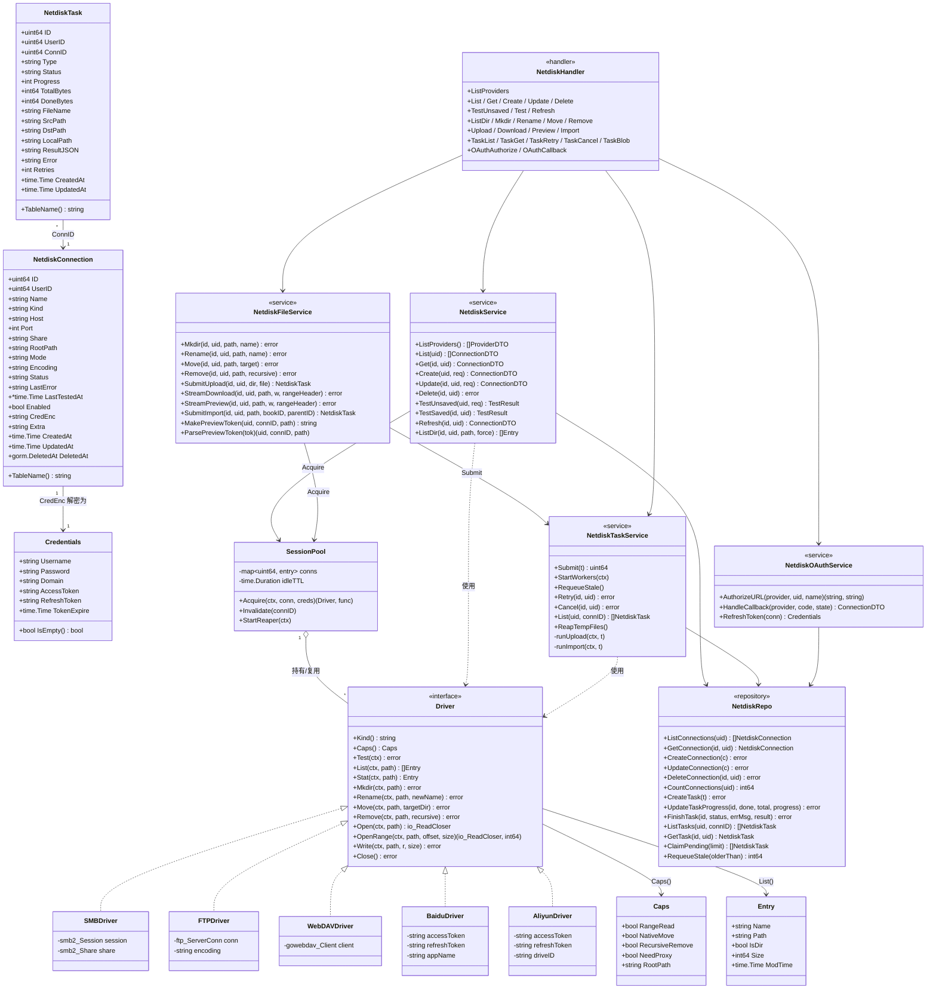
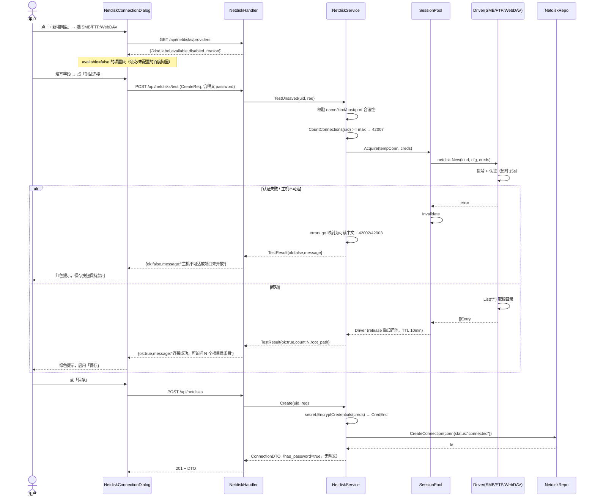
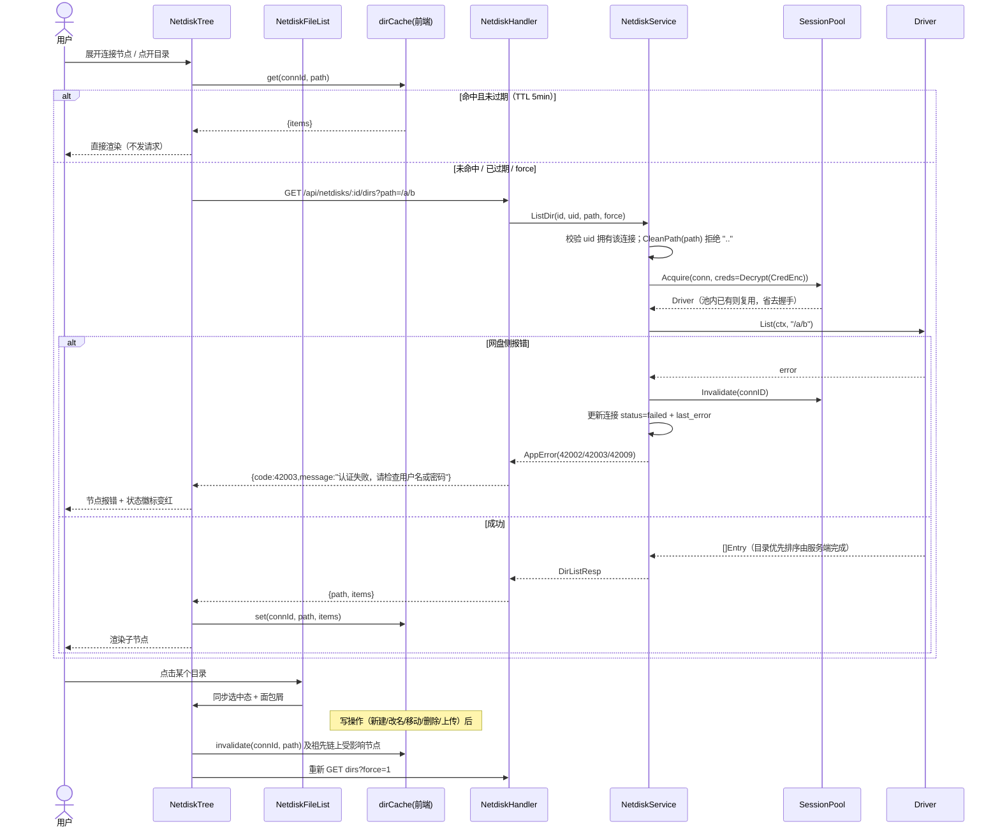
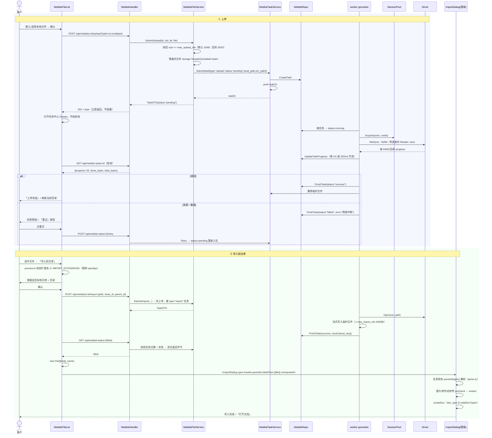
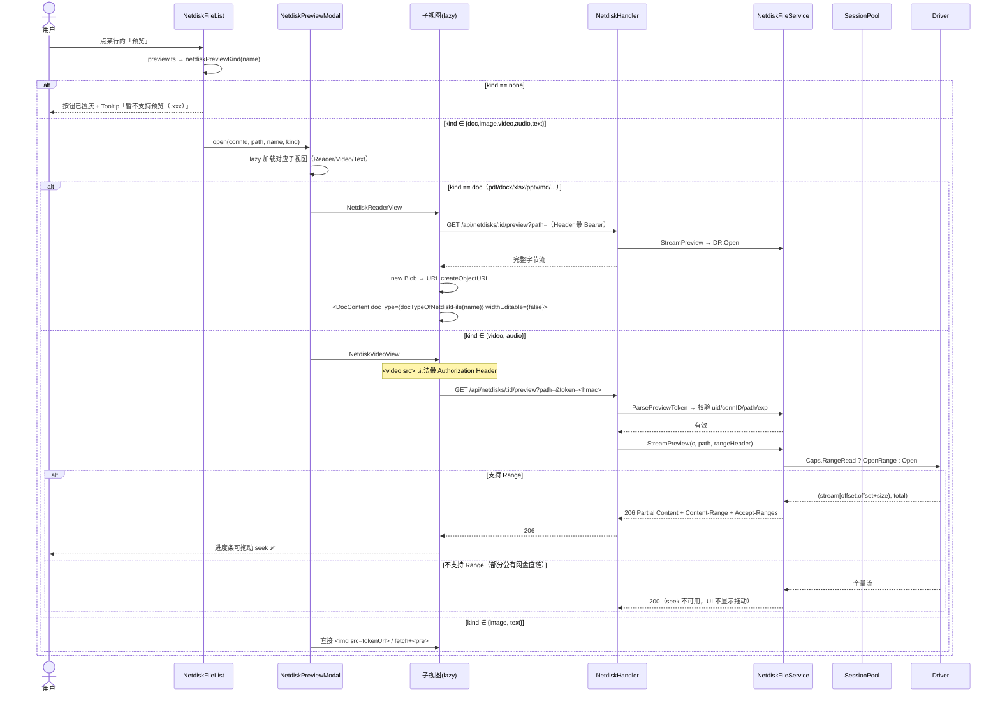
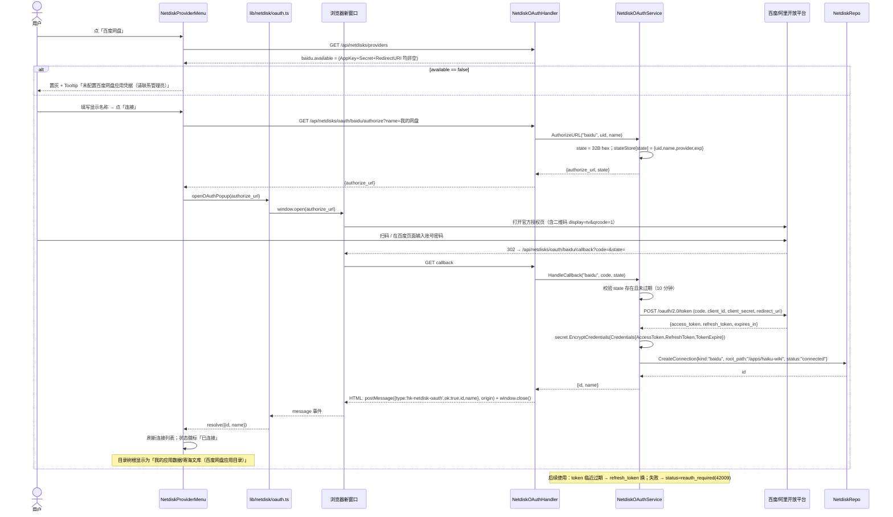
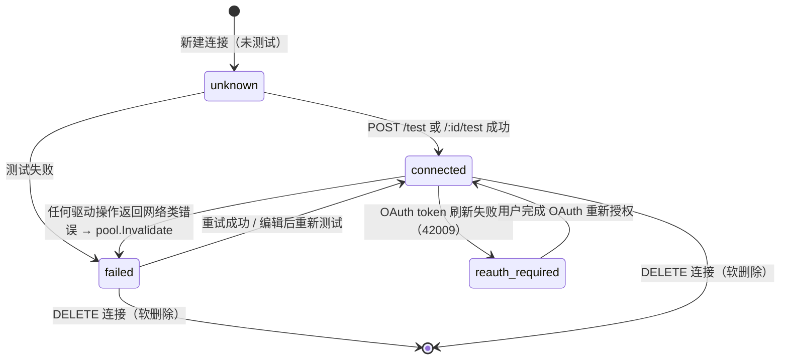
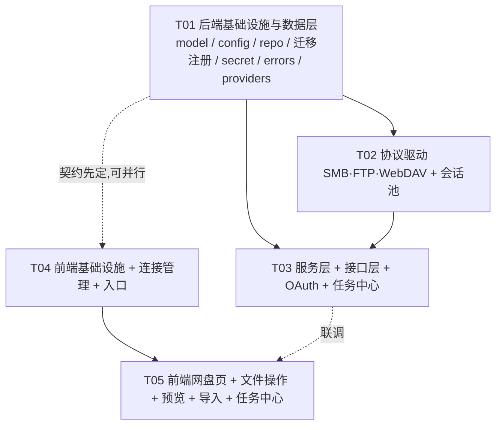

# 系统设计 + 任务分解：我的网盘（haiku_wiki_netdisk）

| 项目信息 | 内容 |
| --- | --- |
| Project Name | `haiku_wiki_netdisk` |
| Language | 简体中文 |
| Programming Language | 后端 Go 1.25 + Gin + GORM（MySQL/SQLite 双驱动）+ JWT；前端 Vite 5 + React 18 + TypeScript + Ant Design |
| 文档类型 | 系统设计（System Design）+ 任务分解 |
| 版本 / 日期 | v1.0 / 2026-10-19 |
| 目标分支 | `v1-netdisk` |
| 上游文档 | `docs/prd-netdisk-20261019.md`（PRD，许清楚） |
| 架构师 | 高见远（Bob） |
| 执行人 | 寇豆码（Engineer） |

---

## 0. 本期范围（以产品方拍板为准，覆盖 PRD 的分档）

| 能力 | 本期状态 | 说明 |
| --- | --- | --- |
| NAS / SMB | **P0 实现** | 补「共享名 share」字段 |
| NAS / FTP | **P0 实现（仅被动模式）** | 主动模式 UI 保留但置灰，见 §1.5 |
| 通用 WebDAV | **P0 实现**（PRD P1-8 提升） | 与 SMB/FTP 并列，作为无开放 API 网盘的可持续替代 |
| 百度网盘 OAuth | **P0 实现**（PRD P1-1 提升） | 接受 `/apps/{appname}` 目录隔离，UI 明示 |
| 阿里云盘 OAuth | **P0 实现**（PRD P1-2 提升） | 配置未就绪 → 自动降级为置灰；若实测无法创建三方应用 → 不填配置即置灰 |
| 夸克网盘 | **置灰保留 + 说明** | 无官方 API |
| 异步任务中心 | **P0 实现**（PRD P1-3 提升） | 承载上传 / 导入 |
| PRD P0-1 ~ P0-16 | **全部实现** | — |
| H5 手机版 | **不做** | — |
| 团队级共享连接 | **不做** | — |

---

## Part A：系统设计

### 1. 实现方案与技术选型

#### 1.1 核心技术难点与对策

| # | 难点 | 对策 |
| --- | --- | --- |
| D1 | 五类异构存储（SMB / FTP / WebDAV / 百度 REST / 阿里 REST）语义不一致 | 抽象统一 `netdisk.Driver` 接口（参照 `storage/` 的 `local.go` + `s3.go` 双驱动范式）。差异用 `Caps()` 能力位表达（是否支持 Range、是否原生 move、是否可递归删、根目录固定值） |
| D2 | SMB/FTP 每次列目录都握手，慢且易耗尽服务端连接 | 新增 `SessionPool`：按连接 ID 复用会话，空闲 10 分钟断开，出错即失效重建 |
| D3 | 凭据不能泄露到前端 | 凭据在 `service` 层解密后**只在进程内传递**，`model` → 前端的 DTO 一律不含 `cred_enc`；`has_password` 布尔位代替明文 |
| D4 | 预览/下载要支持浏览器 Range（`<video>` seek、`pdf.js` 分片） | 后端代理流支持 `206 Partial Content`（P1-4 提前到本期，成本极低）；`<video>/` 不能带 Header → 用 HMAC 短期 `token` 走 query 参数 |
| D5 | 导入到文库不能在 Go 侧重写解析器 | 后端只负责「取字节 → 临时文件」，前端拿 Blob 后 `new File(...)` 直接喂给**现有 `ImportDialog` 的 `initialFiles`**（已实测该 prop 存在且打开即解析），零重复逻辑 |
| D6 | 大文件上传不能阻塞 HTTP 请求 | 上传任务化：handler 落临时文件 → 立即返回 task → worker 异步写网盘 → 进度落库 |
| D7 | 三类公有网盘「能不能用」取决于外部配置/审核状态，硬编码会写出死代码 | 统一 `providers` 能力清单接口：后端按配置推导 `available` + `disabled_reason`，前端**所有菜单项（含夸克）都由该清单渲染**，配置缺失即自动置灰 |
| D8 | 沙箱不能跑浏览器 e2e | 所有验收写成 `go build / go vet / go test ./internal/...` + `tsc --noEmit` + jsdom 单测（纯逻辑部分：路径规范化、缓存失效、预览类型判定、凭据加解密往返、错误映射） |

#### 1.2 分层架构

```
┌─────────────────────────────────────────────────────────────────┐
│ web (Vite + React 18 + TS)                                       │
│   pages/NetdiskPage.tsx          网盘页（lazy 路由 /netdisk/:id） │
│   components/netdisk/*           连接对话框 / 目录树 / 列表 / 预览 │
│   lib/netdisk/*                  常量 / 预览判定 / 目录缓存        │
│   api/netdisk.ts                 接口封装                         │
└─────────────────────────────────────────────────────────────────┘
                              ↓ HTTP /api/netdisks, /api/netdisk-tasks
┌─────────────────────────────────────────────────────────────────┐
│ handler      netdisk_handler.go / netdisk_file_handler.go         │
│              netdisk_task_handler.go / netdisk_oauth_handler.go   │
├─────────────────────────────────────────────────────────────────┤
│ service      netdisk_service.go       连接 CRUD + 测试 + 文件操作  │
│              netdisk_task_service.go  任务中心（worker 池 + 进度） │
│              netdisk_oauth_service.go 百度 / 阿里 OAuth            │
├─────────────────────────────────────────────────────────────────┤
│ netdisk      driver.go（Driver 接口 + 注册 + 类型）                │
│              smb.go / ftp.go / webdav.go / baidu.go / aliyun.go   │
│              pool.go（会话池） secret.go（AES-GCM） errors.go      │
├─────────────────────────────────────────────────────────────────┤
│ repository   netdisk_repo.go                                      │
│ model        netdisk_connection.go / netdisk_task.go              │
│ config       config.go（netdisk 配置段）                          │
└─────────────────────────────────────────────────────────────────┘
```

**为什么把协议客户端放 `server/internal/netdisk/` 而不是 `service/`**：`service` 层已经很重（40+ 文件），协议客户端是「外部资源适配器」，与 `storage/` 的定位完全同构（都是对一种存储介质的适配），独立成包可以单独写单测、不被 service 的业务逻辑污染。PRD §3.5 也建议了这个位置。

#### 1.3 `netdisk.Driver` 接口（统一抽象）

```go
// Package netdisk 统一「外部网盘 / NAS 怎么访问」这件事，对上层屏蔽
// SMB / FTP / WebDAV / 百度网盘 / 阿里云盘 的差异。
package netdisk

// Driver 一种网盘协议的客户端。所有实现必须是「会话级」对象：
// 由 SessionPool 持有并复用，Close() 由池决定是真关还是还池。
type Driver interface {
    // Kind 协议类型：smb | ftp | webdav | baidu | aliyun
    Kind() string
    // Caps 能力位（上层据此决定 UI 是否开放某操作、是否发 Range 请求）
    Caps() Caps
    // Test 测试连接（列一次根目录即可）
    Test(ctx context.Context) error
    // List 列目录。path 是绝对路径（'/' 分隔，根为 "/"）
    List(ctx context.Context, path string) ([]Entry, error)
    // Stat 单条目元信息
    Stat(ctx context.Context, path string) (*Entry, error)
    // Mkdir 新建目录（父目录必须已存在）
    Mkdir(ctx context.Context, path string) error
    // Rename 改名（newName 不含路径）
    Rename(ctx context.Context, path, newName string) error
    // Move 移动到 targetDir 下（同名冲突由实现返回 ErrConflict）
    Move(ctx context.Context, path, targetDir string) error
    // Remove 删除；recursive=true 时删非空目录
    Remove(ctx context.Context, path string, recursive bool) error
    // Open 流式读（下载 / 预览 / 导入取字节）
    Open(ctx context.Context, path string) (io.ReadCloser, error)
    // OpenRange 分段读，返回 [offset, offset+size) 的流与文件总长。
    // 不支持 Range 的实现返回 ErrRangeUnsupported（上层退化为全量 Open）
    OpenRange(ctx context.Context, path string, offset, size int64) (io.ReadCloser, int64, error)
    // Write 写入文件（上传）；size<0 表示长度未知
    Write(ctx context.Context, path string, r io.Reader, size int64) error
    // Close 释放会话
    Close() error
}

// Caps 协议能力位。
type Caps struct {
    RangeRead       bool   // 是否支持分段读（视频 seek）
    NativeMove      bool   // 是否有原生 move（false → 上层做「复制 + 删源」）
    RecursiveRemove bool   // 是否支持递归删目录
    NeedProxy       bool   // true = 无直链，预览/下载必须后端代理（SMB/FTP/WebDAV）
    RootPath        string // 固定根目录（百度 = /apps/<appname>；其余为 "/"）
}

// Entry 目录项。前后端字段名逐字对齐（见 §8 共享知识）。
type Entry struct {
    Name    string    `json:"name"`
    Path    string    `json:"path"`
    IsDir   bool      `json:"is_dir"`
    Size    int64     `json:"size"`
    ModTime time.Time `json:"mod_time"`
}
```

**关键设计取舍**：
- `Caps.NeedProxy` 让「预览走代理流还是直链」成为驱动自述的能力，handler 不用 `switch kind`；
- `Move` 不返回错误即成功；`NativeMove=false` 的驱动（阿里云盘）内部自己实现 copy+delete，对上层透明；
- 百度/阿里的 `Open` 内部走「换取下载直链 → `http.Get`」，因此**接口完全一致**，上层不需要区分。

#### 1.4 会话池策略（`netdisk/pool.go`）

```go
type SessionPool struct {
    mu      sync.Mutex
    conns   map[uint64]*entry // key = 连接 ID
    idleTTL time.Duration     // 默认 10 分钟
}
type entry struct {
    drv      Driver
    refs     int        // 当前引用计数
    lastUsed time.Time
    build    func() (Driver, error)
    mu       sync.Mutex
}
func (p *SessionPool) Acquire(ctx context.Context, conn *model.NetdiskConnection,
                              creds *Credentials) (Driver, func(), error)
func (p *SessionPool) Invalidate(connID uint64)          // 出错时立即丢弃
func (p *SessionPool) StartReaper(ctx context.Context)    // 每 60s 扫一次，空闲超时且 refs=0 则 Close
```

- **复用粒度**：一个 `netdisk_connections` 记录 = 池里一个会话。凭据/配置变更（PUT 编辑）时自动 `Invalidate`。
- **并发**：`entry.mu` 串行化同一会话上的操作（SMB/FTP 会话非并发安全，必须串行）。不同连接之间并行。
- **释放**：`Acquire` 返回 `(drv, release)`，调用方 `defer release()`；`release` 把 `refs--`、`lastUsed=now`。
- **失败处理**：任何驱动方法返回网络类错误 → service 层调 `pool.Invalidate(connID)` 并更新连接状态为 `failed`。
- **单实例假设**：池在进程内存，多实例部署时每实例各自建连（可接受，SMB/FTP 服务端通常允许多连接）。

#### 1.5 FTP 主动模式（PORT）—— 明确处置方案

**事实**：`jlaffaye/ftp v0.2.4` 只有 PASV/EPSV，**没有 PORT 实现，也没有数据连接的扩展点**（`DialWithDialFunc` 只作用于控制连接）。我也实测了另一个主流库 `github.com/secsy/goftp`，其 `Config` 同样**没有**主动模式开关。即：**Go 生态主流 FTP 客户端库均不支持主动模式**，要实现必须 fork 并自行处理 `PORT` 命令 + 客户端侧监听 socket + NAT 穿透。

**推荐方案：① UI 保留选项，被动为唯一实现，主动置灰并给出说明**（成本最低、风险为零、保留未来升级路径）

具体做法：
1. 数据模型保留 `mode` 字段（`passive` / `active`，默认 `passive`），保存时若 `mode=active` → 后端返回 `42008 不支持的操作`，前端在 UI 层就置灰，正常路径不会触达；
2. UI 的「连接模式」Radio 两项都在，**主动**项 `disabled` + Tooltip：「当前版本仅支持被动模式（PASV/EPSV）。主动模式需服务端反向连回，在 NAT/防火墙环境下基本不可用，将在后续版本支持」；
3. `netdisk/ftp.go` 的 `New()` 里对 `mode=active` 直接返回 `ErrUnsupported("FTP 主动模式暂不支持")`，未来换库只改这一个文件。

**为什么不选 ②（自行实现 PORT）**：需 fork 库、自己管监听端口与防火墙；且主动模式在「浏览器 → 后端服务 → FTP 服务端」的三段链路里要求服务端能反向连回部署机，云主机/NAT 环境几乎不可用，投入产出比极差。
**为什么不选 ③（换库）**：已验证没有现成库支持。

#### 1.6 凭据加密（`netdisk/secret.go`）

- 算法：**AES-256-GCM**，密钥 = `SHA256(NetdiskSecretKey)`；`NetdiskSecretKey` 取自 `netdisk.secret_key` 配置 / 环境变量 `NETDISK_SECRET_KEY`，**为空时回落到 `JWTSecret`**（保证零配置也能跑，且换 JWT 密钥会导致网盘凭据失效——这个耦合是可接受的，见 §9-Q11）。
- 明文结构：`Credentials` JSON（见 §3.1 类图），序列化后加密。
- 密文格式：`"v1:" + base64.StdEncoding(nonce[12] || ciphertext)`，`v1` 前缀为未来轮换留口。
- **日志脱敏**：`netdisk.Sanitize(cfg)` 返回去掉所有凭据字段的副本；所有 `log.Printf` 只允许输出 `Sanitize` 结果。

#### 1.7 任务中心（`service/netdisk_task_service.go`）

- **落库**：`netdisk_tasks` 表（状态持久化，PRD §3.4-A 明确要求）；
- **调度**：内存 channel + N 个 worker goroutine（默认 4，`netdisk.task_workers`）；`StartNetdiskTaskWorkers()` 在 `main.go` 里 `go` 起，先执行 `RequeueStale()`：把 `running` 状态且 `updated_at` 超过 10 分钟的任务改回 `pending` 并重新入队（进程崩溃后的自愈）；
- **进度**：worker 每写满 1% 或每 500ms（取先到者）更新一次 `progress/done_bytes`，避免高频写库；
- **取消**：`cancelers map[uint64]context.CancelFunc`（内存）+ 状态置 `canceled`；worker 每步检查 `ctx.Err()`；
- **重试**：只对终态 `failed` 且 `retries < 3` 的任务开放 `POST /:id/retry`（重置为 `pending` 重新入队）；
- **临时文件**：上传的输入、导入的输出落 `storage.TempDir()/netdisk/<task_id>`，任务终态后由 `ReaperTemp()`（每 30 分钟）清理超过 `netdisk.temp_ttl_minutes`（默认 60）的文件。

**取舍说明（与 PRD P1-3 的差异）**：**下载不落任务**。理由：浏览器本身就是下载端，后端代理流天然带进度条，落任务反而要「先落盘、再给一次性链接」，多一次拷贝且用户感知更慢。本期：单文件下载 = 同步流式（`GET .../download`，支持 Range）；多选下载 = 前端逐个触发浏览器下载（不打包 zip，避免引入 zip 依赖与内存风险）。任务中心承载 **上传** 与 **导入** 两类。

#### 1.8 OAuth 流程

- `GET /api/netdisks/oauth/:provider/authorize?name=xxx` → 后端生成 `state`（随机 32 字节 hex），内存 `stateStore`（TTL 10 分钟，含 `uid / name / provider`）→ 返回 `{authorize_url, state}`；
- 前端 `window.open(authorize_url, ...)`；
- 回调 `GET /api/netdisks/oauth/:provider/callback?code=&state=` → 换 token → 创建/更新 `netdisk_connections`（`status=connected`）→ 返回一个 HTML 页，执行 `window.opener.postMessage({type:'hk-netdisk-oauth', ok:true, id, name}, origin); window.close()`；
- 失败同样 postMessage `ok:false, message`。
- 百度：`https://openapi.baidu.com/oauth/2.0/authorize`（追加 `display=tv&qrcode=1` 出二维码），token 端 `/oauth/2.0/token`，`scope=basic,netdisk`；
- 阿里：`https://openapi.alipan.com/oauth/authorize`，token 端 `/oauth/token`，API base `https://openapi.alipan.com`；
- **refresh**：驱动在使用 token 前检查 `token_expire`，临近过期用 `refresh_token` 换；失败 → 连接状态置 `reauth_required` 并返回 `42009`。

#### 1.9 前端按需分包（硬约束）

- `NetdiskPage` 必须 `React.lazy` 注册进 `App.tsx`；
- 预览弹窗 `NetdiskPreviewModal` 内部**再** lazy 三个子视图：
  - `NetdiskReaderView`（内嵌 `DocContent`，会拉 pdf.js / mammoth / FortuneSheet / pptx-preview）
  - `NetdiskVideoView`（`<video>/<audio>`）
  - `NetdiskTextView`（`<pre>`）
- `components/import/ImportDialog` 已经是静态组件（被 BookPage 引），网盘导入页复用它不会新增入口 chunk（ImportDialog 在 BookPage chunk 里）。为避免网盘页 chunk 与 BookPage chunk 各打一份 ImportDialog，Vite 会按 chunk 拆分策略自动处理，不额外干预；
- 样式放 `components/netdisk/netdisk.css`，只在网盘组件内 import，不进全局入口 CSS。

---

### 2. 文件清单

#### 2.1 后端新增文件

| 路径 | 职责 |
| --- | --- |
| `server/internal/model/netdisk_connection.go` | `NetdiskConnection` 模型（连接配置 + 状态 + 加密凭据），表名 `netdisk_connections` |
| `server/internal/model/netdisk_task.go` | `NetdiskTask` 模型（异步任务：上传 / 导入），表名 `netdisk_tasks` |
| `server/internal/netdisk/driver.go` | `Driver` 接口、`Caps`、`Entry`、kind 常量、工厂 `New(kind, cfg, creds)`、错误哨兵 |
| `server/internal/netdisk/path.go` | 路径规范化：`CleanPath` / `Join` / `BaseName` / `Parent` / `IsRoot`；拒绝 `..` 穿越 |
| `server/internal/netdisk/secret.go` | AES-256-GCM 凭据加解密 + `Sanitize` 日志脱敏 |
| `server/internal/netdisk/errors.go` | 各协议/平台原始错误 → 统一 `AppError` 码 + 人类可读中文（见 §8 错误码表） |
| `server/internal/netdisk/pool.go` | `SessionPool`：会话复用、idle TTL、失效、Reaper |
| `server/internal/netdisk/smb.go` | SMB 驱动（`hirochachacha/go-smb2`） |
| `server/internal/netdisk/ftp.go` | FTP 驱动（`jlaffaye/ftp`），含 GBK/UTF-8 编码转换、被动模式 |
| `server/internal/netdisk/webdav.go` | WebDAV 驱动（`studio-b12/gowebdav`） |
| `server/internal/netdisk/baidu.go` | 百度网盘 OAuth2 + REST 驱动（列目录/上传三段式/文件管理） |
| `server/internal/netdisk/aliyun.go` | 阿里云盘 OAuth2 + OpenAPI 驱动 |
| `server/internal/netdisk/providers.go` | provider 能力清单：按配置推导 `available` / `disabled_reason`（夸克恒 false） |
| `server/internal/netdisk/driver_test.go` | 单测：路径规范化、Caps 常量、工厂分派、**含凭据 JSON 结构的 mock 驱动** |
| `server/internal/netdisk/secret_test.go` | 单测：加解密往返、篡改密文必失败、Sanitize 不含明文 |
| `server/internal/netdisk/errors_test.go` | 单测：百度 `20011/20012/20013`、阿里 `403`、SMB/FTP 常见错误的映射断言 |
| `server/internal/netdisk/path_test.go` | 单测：路径穿越拒绝、根路径、BaseName/Parent |
| `server/internal/repository/netdisk_repo.go` | 两张表的 CRUD + 按用户计数 + 任务队列查询（pending 取任务、stale 重置） |
| `server/internal/service/netdisk_service.go` | 连接 CRUD、测试连接、列目录、新建/改名/移动/删除、provider 清单 |
| `server/internal/service/netdisk_file_service.go` | 上传落临时、下载/预览代理流（含 Range 与 HMAC token）、导入取字节 |
| `server/internal/service/netdisk_task_service.go` | 任务中心：提交、worker 池、进度、取消、重试、stale 恢复、临时文件清理 |
| `server/internal/service/netdisk_oauth_service.go` | 百度 / 阿里 OAuth：state 管理、authorize URL、回调换 token、refresh |
| `server/internal/handler/netdisk_handler.go` | 连接 CRUD + `/test` + `/refresh` + `/providers` |
| `server/internal/handler/netdisk_file_handler.go` | 目录、新建、改名、移动、删除、上传、下载、预览、导入 |
| `server/internal/handler/netdisk_task_handler.go` | 任务列表 / 详情 / 重试 / 取消 / blob 取字节 |
| `server/internal/handler/netdisk_oauth_handler.go` | OAuth authorize / callback |
| `server/internal/handler/netdisk_dto.go` | 入参/出参 DTO（含 `ToConnectionDTO` 脱敏函数，集中一处避免散落） |
| `server/internal/service/netdisk_service_test.go` | 单测：DTO 脱敏不含凭据、测试连接的参数校验、大小上限拦截 |

#### 2.2 后端修改文件

| 路径 | 改动 |
| --- | --- |
| `server/internal/config/config.go` | 新增 `netdisk` 段的扁平字段（`NetdiskSecretKey` / `Baidu*` / `Aliyun*` / 限值 / 池参数）；`fileConfig` 增 `netdisk netdiskSection`；`applyFile` / `applyEnv` 三通道对齐（照抄 WeChat 写法） |
| `server/internal/repository/database.go` | `AutoMigrate()` 的 `g.AutoMigrate(...)` 列表**末尾**追加 `&model.NetdiskConnection{}`、`&model.NetdiskTask{}` |
| `server/internal/service/migrate_service.go` | `migrateTables` 末尾追加 `{"netdisk_connections", copyRows[model.NetdiskConnection]}`、`{"netdisk_tasks", copyRows[model.NetdiskTask]}`（**漏登记 = 系统迁移静默丢表**） |
| `server/internal/router/router.go` | 在 `jwt` 组内新增 `netdisks := jwt.Group("/netdisks")` 与 `tasks := jwt.Group("/netdisk-tasks")`；OAuth 的 `authorize`/`callback` 挂在同一 `netdisks` 组下 |
| `server/cmd/server/main.go` | 启动 `go service.StartNetdiskTaskWorkers()` + `netdisk.DefaultPool().StartReaper(ctx)`（照抄 `go service.StartApiRefreshScheduler()` 的位置） |
| `conf/application.yml` | 增 `netdisk:` 段（全部留空 + 注释说明），**不填任何真实凭据** |
| `server/go.mod` / `server/go.sum` | 新增 3 个直接依赖（见 §6） |

#### 2.3 前端新增文件

| 路径 | 职责 |
| --- | --- |
| `web/src/api/netdisk.ts` | 全部网盘接口封装（连接、目录、文件、任务、OAuth） |
| `web/src/lib/netdisk/constants.ts` | kind / 状态 / 任务状态枚举与中文标签 + 颜色；`NETDISK_KINDS` 常量数组（与后端逐字对齐） |
| `web/src/lib/netdisk/path.ts` | 前端路径工具（`normalizePath` / `joinPath` / `parentPath` / `baseName`），与后端 `path.go` 同一口径 |
| `web/src/lib/netdisk/preview.ts` | `netdiskPreviewKind(name)`：→ `'doc' \| 'image' \| 'video' \| 'audio' \| 'text' \| 'none'`；`docTypeOfNetdiskFile(name)`：可渲染类型 → `DocType`（供 `DocContent`）；**独立函数，不污染 `lib/attachment.ts`** |
| `web/src/lib/netdisk/dirCache.ts` | 目录缓存 `Map<connId::path, {items, ts}>`，TTL 5 分钟；写操作后失效本目录 + 祖先链 |
| `web/src/lib/netdisk/format.ts` | 字节数 / 时间格式化（列表与预览共用，避免各写一份） |
| `web/src/lib/netdisk/oauth.ts` | `openOAuthPopup(provider, name)`：开窗 + `postMessage` 监听 + Promise 化 |
| `web/src/components/netdisk/NetdiskProviderMenu.tsx` | 「+ 新增网盘」Dropdown；项由 `providers` 接口渲染，不可用项置灰 + Tooltip |
| `web/src/components/netdisk/NetdiskConnectionDialog.tsx` | SMB / FTP / WebDAV 配置对话框（测试连接 → 保存），编辑态密码「已保存，留空则不修改」 |
| `web/src/components/netdisk/NetdiskCard.tsx` | 连接卡片（首页网格用），状态徽标 + 悬浮编辑/删除 |
| `web/src/components/netdisk/NetdiskSection.tsx` | 首页「我的网盘」区块（与「书架」同级 `<section>`） |
| `web/src/components/netdisk/NetdiskTree.tsx` | 网盘页左侧目录树（懒加载，逐级展开） |
| `web/src/components/netdisk/NetdiskFileList.tsx` | 右侧面包屑 + 工具栏 + 文件/目录表格 + 行操作 |
| `web/src/components/netdisk/NetdiskMoveDialog.tsx` | 移动目标目录树选择（网盘内） |
| `web/src/components/netdisk/NetdiskPreviewModal.tsx` | 预览弹窗外壳（内部 lazy 三个子视图） |
| `web/src/components/netdisk/NetdiskReaderView.tsx` | 文库可渲染类型：Blob → `DocContent`（`widthEditable={false}`） |
| `web/src/components/netdisk/NetdiskVideoView.tsx` | 视频 / 音频：`<video controls src={tokenUrl}>` |
| `web/src/components/netdisk/NetdiskTextView.tsx` | 纯文本 / 代码：`<pre>` + 复制按钮 |
| `web/src/components/netdisk/NetdiskImportDialog.tsx` | 选目标知识库 + 目录 → 建导入任务 → 取 Blob → `new File()` → 喂给现有 `ImportDialog(initialFiles)` |
| `web/src/components/netdisk/NetdiskTaskCenter.tsx` | 任务中心 Drawer（进度列表 / 重试 / 取消） |
| `web/src/components/netdisk/netdisk.css` | 网盘模块样式（随 chunk 加载，不进入口 CSS） |
| `web/src/pages/NetdiskPage.tsx` | 网盘页主体（三栏：目录树 + 列表 + 弹窗层） |
| `web/scripts/verify-netdisk-preview.mjs` | jsdom 单测：预览类型判定表、路径工具、目录缓存失效（esbuild 转译 → 无浏览器依赖） |

#### 2.4 前端修改文件

| 路径 | 改动 |
| --- | --- |
| `web/src/types.ts` | 新增 `NetdiskKind` / `NetdiskStatus` / `NetdiskConnection` / `NetdiskEntry` / `NetdiskTask` / `NetdiskProvider` 类型 |
| `web/src/App.tsx` | `const NetdiskPage = lazy(() => import('./pages/NetdiskPage'))`；在 AppLayout 内注册 `/netdisk/:id`（`LazyBoundary`） |
| `web/src/layouts/AppLayout.tsx` | 顶栏在「我的知识库」与「团队」之间增「我的网盘」图标入口（跳 `/netdisk`）；右侧增任务中心入口（铃铛/进度图标） |
| `web/src/pages/DashboardPage.tsx` | 在 `<BookshelfSection>` 之后挂同级 `<section><NetdiskSection /></section>` |
| `web/src/components/tree/KnowledgeTree.tsx` | 新增可选 prop `netdiskGroup`；`NodeRaw.kind` 扩展 `netdisk-cat` / `netdisk-conn` / `netdisk-dir`；`rebuildTop` 在「公司知识库」之后追加「我的网盘」分组；`onLoadData` 按 kind 分派到注入的 `loadDir` |

> **不改 `ImportDialog.tsx`**：网盘导入通过 `initialFiles` prop 复用它，现有导入链路零改动（沙箱无法跑 e2e，改它风险不可控）。

---

### 3. 数据结构与接口

#### 3.1 类图（Mermaid）



#### 3.2 GORM 模型要点

**`netdisk_connections`**
- 主键：自增 `id`（**严禁复合主键** —— GORM 无法就地给复合主键表补自增主键，项目历史教训）
- 索引：`index(idx_user)` on `user_id`；`uniqueIndex(uk_netdisk_user_name)` on `(user_id, name)`；`index` on `kind`
- 加密字段：`CredEnc` —— `type:text`（密文长度随凭据变化，SQLite/MySQL 两边都能迁；不用 `size:` 避免 MySQL utf8mb4 索引长度问题，它不进索引所以安全）
- `Status` 默认值 `unknown`；`Enabled` 默认 `true`
- 软删除：`gorm.DeletedAt`，与项目其它表一致

**`netdisk_tasks`**
- 主键：自增 `id`
- 索引：`index` on `(user_id)`；`index` on `(conn_id)`；`index` on `(status)`（worker 查 pending 用）
- 不用外键约束（项目现有表均未用 FK，避免 MySQL/SQLite 行为差异）
- `Progress` 0–100 整数
- `ResultJSON` 存成功产物（如 `{"book_id":1,"doc_id":2}`）

#### 3.3 关键 DTO（`handler/netdisk_dto.go`）

```go
// ConnectionDTO 出参。**永不携带任何凭据字段**。
type ConnectionDTO struct {
    ID           uint64     `json:"id"`
    Name         string     `json:"name"`
    Kind         string     `json:"kind"`            // smb|ftp|webdav|baidu|aliyun
    Host         string     `json:"host"`
    Port         int        `json:"port"`
    Share        string     `json:"share,omitempty"`
    RootPath     string     `json:"root_path"`       // 百度为 /apps/<appname>
    Mode         string     `json:"mode,omitempty"`  // ftp: passive|active
    Encoding     string     `json:"encoding,omitempty"`
    Status       string     `json:"status"`          // unknown|connected|failed|reauth_required
    LastError    string     `json:"last_error,omitempty"`
    LastTestedAt *time.Time `json:"last_tested_at,omitempty"`
    Enabled      bool       `json:"enabled"`
    HasPassword  bool       `json:"has_password"`    // 唯一暴露的凭据信息
    HasToken     bool       `json:"has_token"`
    Account      string     `json:"account,omitempty"` // 公有网盘昵称/账号（非敏感）
    CreatedAt    time.Time  `json:"created_at"`
    UpdatedAt    time.Time  `json:"updated_at"`
}

// CreateReq 入参。password 为空表示「不修改」（编辑态）。
type CreateReq struct {
    Name     string `json:"name" binding:"required"`
    Kind     string `json:"kind" binding:"required"`
    Host     string `json:"host"`
    Port     int    `json:"port"`
    Share    string `json:"share"`
    Mode     string `json:"mode"`
    Encoding string `json:"encoding"`
    Username string `json:"username"`
    Password string `json:"password"`
    Domain   string `json:"domain"`
}

// ProviderDTO 能力清单。前端全部菜单项由它渲染，不可用即置灰。
type ProviderDTO struct {
    Kind           string `json:"kind"`            // smb|ftp|webdav|baidu|aliyun|quark
    Label          string `json:"label"`
    Available      bool   `json:"available"`
    DisabledReason string `json:"disabled_reason,omitempty"`
    OAuth          bool   `json:"oauth"`           // true = 点它走授权跳转而不是配置对话框
}

// TestResult 测试连接结果。
type TestResult struct {
    OK       bool   `json:"ok"`
    Message  string `json:"message"`
    RootPath string `json:"root_path,omitempty"`
    Count    int    `json:"count,omitempty"`   // 根目录条目数（成功时给，如「可访问 N 个条目」）
}

// DirListResp 列目录。
type DirListResp struct {
    Path   string  `json:"path"`
    Items  []Entry `json:"items"`
    Cached bool    `json:"cached"`   // 是否来自服务端短缓存（调试用）
}

// TaskDTO 任务。
type TaskDTO struct {
    ID         uint64 `json:"id"`
    ConnID     uint64 `json:"conn_id"`
    ConnName   string `json:"conn_name"`
    Type       string `json:"type"`     // upload|import
    Status     string `json:"status"`   // pending|running|success|failed|canceled
    Progress   int    `json:"progress"`
    TotalBytes int64  `json:"total_bytes"`
    DoneBytes  int64  `json:"done_bytes"`
    FileName   string `json:"file_name"`
    SrcPath    string `json:"src_path"`
    DstPath    string `json:"dst_path"`
    Error      string `json:"error,omitempty"`
    Retries    int    `json:"retries"`
    CreatedAt  time.Time `json:"created_at"`
    UpdatedAt  time.Time `json:"updated_at"`
}
```

#### 3.4 接口清单（最终版，挂在 `jwt := api.Group("", middleware.JWTAuth())` 下）

| 方法 | 路径 | 说明 |
| --- | --- | --- |
| GET | `/api/netdisks/providers` | 能力清单（含夸克置灰原因） |
| GET | `/api/netdisks` | 连接列表 |
| POST | `/api/netdisks` | 新建（smb/ftp/webdav 保存；baidu/aliyun 返回 `authorize_url`） |
| POST | `/api/netdisks/test` | 测试**未保存**的配置（保存前测试，UI 强制先测后存） |
| GET | `/api/netdisks/:id` | 详情（脱敏） |
| PUT | `/api/netdisks/:id` | 编辑 |
| DELETE | `/api/netdisks/:id` | 删除 |
| POST | `/api/netdisks/:id/test` | 测试已保存连接 |
| POST | `/api/netdisks/:id/refresh` | 刷新状态 |
| GET | `/api/netdisks/:id/dirs?path=&force=` | 列目录（懒加载；`force=1` 跳过服务端短缓存） |
| POST | `/api/netdisks/:id/dirs` | 新建目录 `{path, name}` |
| POST | `/api/netdisks/:id/rename` | `{path, name}` |
| POST | `/api/netdisks/:id/move` | `{path, target_dir}` |
| DELETE | `/api/netdisks/:id/items?path=&recursive=` | 删除 |
| POST | `/api/netdisks/:id/upload?path=` | 上传（multipart）→ 返回 task |
| GET | `/api/netdisks/:id/download?path=&token=` | 下载（代理流，支持 Range） |
| GET | `/api/netdisks/:id/preview?path=&token=` | 预览（代理流，支持 Range；token 供 `<video>/` 免 Header 直连） |
| POST | `/api/netdisks/:id/import` | `{path, book_id, parent_id}` → 返回 task |
| GET | `/api/netdisk-tasks?conn_id=&status=&limit=` | 任务列表 |
| GET | `/api/netdisk-tasks/:id` | 任务详情（轮询进度） |
| POST | `/api/netdisk-tasks/:id/retry` | 重试（仅 failed 且 retries<3） |
| DELETE | `/api/netdisk-tasks/:id` | 取消 |
| GET | `/api/netdisk-tasks/:id/blob` | 导入任务成功后取字节（供前端解析） |
| GET | `/api/netdisks/oauth/:provider/authorize?name=` | 发起授权 → `{authorize_url, state}` |
| GET | `/api/netdisks/oauth/:provider/callback` | 回调换 token → HTML + postMessage |

---

### 4. 程序调用流程

#### 4.1 新建 SMB/FTP/WebDAV 连接 + 测试连接



#### 4.2 浏览目录（含缓存失效）



#### 4.3 上传 / 导入任务化



#### 4.4 预览（含 Range 与短期 token）



#### 4.5 百度 / 阿里 OAuth 授权回调



#### 4.6 连接状态流转（与 PRD §4.8 一致，补触发点）



---

### 5. Anything UNCLEAR（假设与遗留问题）

见 §9「待明确事项」。此处记录**已做的假设**（工程师按此实现，无需再确认）：
1. 假设每用户连接上限 10、上传上限 2GB、导入上限 200MB（取 PRD Q9/Q10 的建议值）。
2. 假设 SMB/FTP 允许匿名（用户名密码均留空即匿名），对应 PRD Q14 的建议。
3. 假设预览白名单包含音频与纯文本/代码（PRD Q8 的建议）。
4. 假设凭据加密密钥回落到 `JWTSecret`（PRD Q11 的「随现有服务端配置走」）。
5. 假设 FTP 主动模式本期置灰（§1.5）。
6. 假设下载不落任务（§1.7）。
7. 假设 OAuth state 与任务 worker 均为单实例内存态（多实例需另行改造，见 §9）。

---

## Part B：任务分解

### 6. 依赖包清单

#### 6.1 Go 新增依赖（`server/go.mod`）

```
- github.com/hirochachacha/go-smb2 v1.1.0：SMB2/3 客户端（仅 NTLMv2；已实测 go get 通过）
- github.com/jlaffaye/ftp v0.2.4：FTP 客户端（仅被动模式；已实测 go get 通过）
- github.com/studio-b12/gowebdav v0.13.0：WebDAV 客户端（含 ReadStreamRange，实测可拉取）
- golang.org/x/text v0.21.0：FTP 中文文件名 GBK↔UTF-8 转换（encoding/simplifiedchinese）。
  当前已是 indirect 依赖，直接使用后需由 `go mod tidy` 提升为 direct。
```

**不新增**：
- 加解密用标准库 `crypto/aes` + `crypto/cipher` + `crypto/rand` + `crypto/sha256` + `crypto/hmac`；
- 百度/阿里 OAuth 与 REST 用标准库 `net/http` + `encoding/json`（避免引入 SDK，两个平台接口面很小）；
- `golang.org/x/sync/singleflight` 不需要（会话池用 mutex 已够）。

#### 6.2 前端依赖

**不新增任何 npm 依赖。**
- 秒传复用现有 `spark-md5`（`lib/uploadFlow.ts` 已封装 `uploadWithDedup`）；
- 视频/音频用原生 `<video>` / `<audio>`；图片用 antd `Image`；纯文本用 `<pre>`；
- 目录树用 antd `Tree`（现有 KnowledgeTree 同款）；
- jsdom 单测复用 `esbuild`（`web/scripts/verify-code-copy.mjs` 同款，已在 devDependencies）。

---

### 7. 任务列表（有序，工程师直接执行）

> **验收方式的硬约束**：本沙箱可用 `go build ./...` / `go vet ./...` / `go test ./internal/...` / `gofmt -l .`，
> 以及 `node web/node_modules/typescript/bin/tsc --noEmit -p web/tsconfig.json` 与 jsdom 单测。
> `npm run build` 与浏览器 e2e 在沙箱不可用 → **界面级整站回归需在正常环境补跑**，交付报告必须如实注明。
>
> **Go 编译前必须**（否则会「静默什么都不做」或 `/tmp` 空间不足）：
> ```bash
> export PATH=/usr/local/go/bin:$PATH GOPATH=/home/macro/go GOMODCACHE=/home/macro/go/pkg/mod \
>        GOCACHE=/home/macro/.cache/go-build GOPROXY=goproxy.cn GOSUMDB=off GOTOOLCHAIN=local \
>        TMPDIR=/home/macro/.workbuddy/tmp HOME=/home/macro
> ```

---

#### T01 — 后端基础设施与数据层

- **优先级**：P0
- **依赖**：无
- **涉及文件**
  - 新增：`server/internal/model/netdisk_connection.go`、`server/internal/model/netdisk_task.go`
  - 新增：`server/internal/netdisk/driver.go`、`path.go`、`secret.go`、`errors.go`、`providers.go`
  - 新增：`server/internal/netdisk/path_test.go`、`secret_test.go`、`errors_test.go`
  - 新增：`server/internal/repository/netdisk_repo.go`
  - 修改：`server/internal/config/config.go`（netdisk 段：字段 + `netdiskSection` + `applyFile` + `applyEnv`，照抄 WeChat 三通道）
  - 修改：`server/internal/repository/database.go`（`AutoMigrate` 末尾追加两个模型）
  - 修改：`server/internal/service/migrate_service.go`（`migrateTables` 末尾追加两条）
  - 修改：`conf/application.yml`（增 `netdisk:` 段，全部留空 + 注释）
  - 修改：`server/go.mod` / `go.sum`（`go get` 三个新依赖）
- **要点**
  - 两张表都用自增 `id` 主键，**绝不用复合主键**
  - `uk_netdisk_user_name` on `(user_id, name)`；`CredEnc` 用 `type:text`
  - `Driver` 接口先只声明签名，实现留 T02（本期先让 `netdisk.New()` 对未实现 kind 返回 `ErrUnsupported`）
  - 错误码段 `42xxx`（见 §8）在 `errors.go` 集中定义
  - `providers.go`：`quark` 恒 `available=false`，理由「官方暂未开放第三方 API」；`baidu`/`aliyun` 按配置三项是否齐全推导
- **验收**
  ```bash
  cd server && go build ./...            # 0 错误
  gofmt -l .                             # 无输出行
  go vet ./...                           # 0 错误
  go test ./internal/netdisk/... ./internal/repository/... ./internal/service/...
  ```
  并且：`grep -n "NetdiskConnection" internal/repository/database.go` 与 `internal/service/migrate_service.go` 各自至少 1 处命中（防漏登记）。

---

#### T02 — 后端协议驱动（SMB / FTP / WebDAV）+ 会话池

- **优先级**：P0
- **依赖**：T01
- **涉及文件**
  - 新增：`server/internal/netdisk/smb.go`、`ftp.go`、`webdav.go`、`pool.go`、`driver_test.go`
  - 修改：`server/internal/netdisk/driver.go`（补全 `New()` 工厂分派 smb/ftp/webdav）
  - 修改：`server/internal/netdisk/errors.go`（补三种协议的错误映射）
- **要点**
  - **SMB**：`smb2.Dialer{Initiator: &smb2.NTLMInitiator{User, Password, Domain}}` → `DialContext` → `Mount(share)`；`Share` 提供类 `os` 的 `ReadDir/Create/Open/Remove/Rename/MkdirAll/RemoveAll`；**只支持 NTLMv2，不支持 Kerberos**
  - **FTP**：`ftp.Dial(addr, ftp.DialWithTimeout(15s), ftp.DialWithContext(ctx))`；登录 `Login(user, pass)`；编码：`Encoding=="gbk"` 时用 `golang.org/x/text/encoding/simplifiedchinese.GBK` 对文件名做双向转换；`List` 用 `c.List(path)`（类型区分靠 `Entry.Type`，`EntryTypeFolder`）；**`Mode=="active"` 直接返回 `ErrUnsupported`（§1.5）**
  - **WebDAV**：`gowebdav.NewClient(hostURL, user, pass)` → `SetTimeout(15s)` → `Connect()`；`ReadDir` / `Mkdir` / `Rename(old,new,false)` / `Remove` / `RemoveAll` / `ReadStream` / `ReadStreamRange` / `WriteStreamWithLength`；`Stat` 用 `client.Stat`
  - **Caps**：SMB/FTP/WebDAV 均 `RangeRead=true`（FTP 靠 `RetrFrom`、SMB 靠随机读、WebDAV 靠 `ReadStreamRange`）、`NeedProxy=true`、`RootPath="/"`
  - **pool.go**：`Acquire` 返回 `(Driver, release)`；`entry.mu` 串行化同一会话；`Invalidate`；`StartReaper`（60s 扫，idle>10min 且 refs=0 则 Close）
  - 路径一律过 `path.go` 的 `CleanPath`（拒绝 `..`、统一 `/` 分隔、根为 `/`）
- **验收**
  ```bash
  cd server && go build ./... && go vet ./... && gofmt -l .
  go test ./internal/netdisk/... -run 'Path|Driver|Secret|Error|Pool' -count=1
  ```
  单测必须覆盖：路径穿越（`/a/../../etc` 被拒）、FTP active 返回 `ErrUnsupported`、凭据加密往返、百度 `20011` / 阿里 `403` 映射文案。

---

#### T03 — 后端服务层 + 接口层 + OAuth + 任务中心

- **优先级**：P0
- **依赖**：T01、T02
- **涉及文件**
  - 新增：`server/internal/service/netdisk_service.go`、`netdisk_file_service.go`、`netdisk_task_service.go`、`netdisk_oauth_service.go`
  - 新增：`server/internal/service/netdisk_service_test.go`（DTO 脱敏 / 参数校验 / 上限拦截）
  - 新增：`server/internal/handler/netdisk_handler.go`、`netdisk_file_handler.go`、`netdisk_task_handler.go`、`netdisk_oauth_handler.go`、`netdisk_dto.go`
  - 新增：`server/internal/netdisk/baidu.go`、`aliyun.go`（百度/阿里驱动）
  - 修改：`server/internal/router/router.go`（`jwt` 组内注册 `/netdisks` 与 `/netdisk-tasks`）
  - 修改：`server/cmd/server/main.go`（`go service.StartNetdiskTaskWorkers()`、`netdisk.DefaultPool().StartReaper(ctx)`）
- **要点**
  - **脱敏是硬要求**：所有出参必须经 `netdisk_dto.go` 的 `ToConnectionDTO`，**任何路径都不得把 `cred_enc` / `password` / `token` 写进响应**；单测断言 `strings.Contains(body,"password")==false`
  - **预览/下载 token**：`MakePreviewToken = base64url(hmac_sha256(secret, uid|connID|path|exp))`，`"exp.token"` 形式，有效期 2h；`ParsePreviewToken` 校验 uid 一致
  - **Range**：解析 `Range: bytes=a-b`；驱动支持则 `OpenRange` 返回 206 + `Content-Range` + `Accept-Ranges: bytes`，否则 200 全量；**`Content-Disposition` 下载用 `attachment`，预览用 `inline`**
  - **任务中心**：`StartNetdiskTaskWorkers` 先 `RequeueStale()`（running 且 >10min 未更新 → pending 重入队）；worker 数取 `netdisk.task_workers`（默认 4）；进度节流（1% 或 500ms）；`Retry` 仅 `failed && retries<3`
  - **导入**：`POST /import` 只建任务；`GET /netdisk-tasks/:id/blob` 在任务 success 后流式返回临时文件字节，并校验 `task.user_id == uid`
  - **百度**：`root_path="/apps/<baidu_app_name>"`；列表 `/rest/2.0/xpan/file?method=list`；上传三段式 `precreate → superfile2 → create`（分片 ≤1024）；错误码 `20011/20012/20013` 映射
  - **阿里**：`https://openapi.alipan.com/oauth/authorize|token`；`/adrive/v1/file/list`、`/adrive/v1/file/create|update|delete|move`；下载直链 `/adrive/v1/file/get_download_url`；`403` → 「当前下载并发已达上限，请稍后重试」
  - **OAuth 回调页**：返回最小 HTML，`postMessage({type:'hk-netdisk-oauth', ok, id, name, message}, origin)` + `window.close()`（`origin` 取 `Origin` 请求头，不要用 `*`）
- **验收**
  ```bash
  cd server && go build ./... && go vet ./... && gofmt -l .
  go test ./internal/... -count=1
  ```
  补充断言（可写成 `router_test.go` 风格的 httptest 用例，或至少 grep 校验）：
  - `grep -n "netdisks" internal/router/router.go` 有命中；
  - `grep -rn "cred_enc" internal/handler/` **零命中**（防误把模型直接序列化出去）；
  - `netdisk_service_test.go` 断言 DTO 无 `password` / `token` 字段。

---

#### T04 — 前端基础设施 + 连接管理 + 入口

- **优先级**：P0
- **依赖**：T01（接口契约）；**可与 T02/T03 并行开发**（先用 mock 数据）
- **涉及文件**
  - 新增：`web/src/api/netdisk.ts`
  - 新增：`web/src/lib/netdisk/constants.ts`、`path.ts`、`preview.ts`、`dirCache.ts`、`format.ts`、`oauth.ts`
  - 新增：`web/src/components/netdisk/NetdiskProviderMenu.tsx`、`NetdiskConnectionDialog.tsx`、`NetdiskCard.tsx`、`NetdiskSection.tsx`、`netdisk.css`
  - 新增：`web/scripts/verify-netdisk-preview.mjs`（jsdom 单测）
  - 修改：`web/src/types.ts`
  - 修改：`web/src/App.tsx`（lazy 注册 `/netdisk/:id`）
  - 修改：`web/src/layouts/AppLayout.tsx`（顶栏「我的网盘」入口 + 任务中心入口）
  - 修改：`web/src/pages/DashboardPage.tsx`（挂 `NetdiskSection`）
  - 修改：`web/src/components/tree/KnowledgeTree.tsx`（顶层「我的网盘」分组，注入式）
- **要点**
  - `preview.ts` 是**独立函数**，绝不改 `lib/attachment.ts` 的 `attachmentKind()`
  - 导入白名单直接 `import { IMPORT_EXTENSIONS } from '../import/formats'`，**禁止另写一份**；剔除 `wps`/`dps`
  - `KnowledgeTree` 改动必须保持**向后兼容**：`netdiskGroup` 为可选 prop，不传时行为与今天完全一致（零回归）
  - `NetdiskSection` 在 `<BookshelfSection>` 之后作为**同级 `<section>`**，标题 `hk-dash-section-title`「我的网盘」
  - `NetdiskProviderMenu` 的所有项（含夸克）由 `GET /api/netdisks/providers` 渲染，`available=false` → `disabled` + `Tooltip(disabled_reason)`
  - 编辑态密码框 placeholder「已保存，留空则不修改」，提交时 `password: ""` 表示不修改
  - 所有请求走 `api/request.ts`（统一 `{code,message,data}` 与 401 处理）
- **验收**
  ```bash
  cd web && node node_modules/typescript/bin/tsc --noEmit -p tsconfig.json   # 0 错误
  node scripts/verify-netdisk-preview.mjs                                     # 全绿
  ```
  jsdom 单测覆盖：`netdiskPreviewKind` 对 `pdf/mp4/png/json/xyz` 的判定；`joinPath`/`parentPath`；`dirCache` 写操作后祖先链失效；`IMPORT_EXTENSIONS` 白名单不含 `wps`/`dps`。

---

#### T05 — 前端网盘页 + 文件操作 + 预览 + 导入 + 任务中心

- **优先级**：P0
- **依赖**：T04（可并行到 T03 完成后联调）
- **涉及文件**
  - 新增：`web/src/pages/NetdiskPage.tsx`
  - 新增：`web/src/components/netdisk/NetdiskTree.tsx`、`NetdiskFileList.tsx`、`NetdiskMoveDialog.tsx`
  - 新增：`web/src/components/netdisk/NetdiskPreviewModal.tsx`、`NetdiskReaderView.tsx`、`NetdiskVideoView.tsx`、`NetdiskTextView.tsx`
  - 新增：`web/src/components/netdisk/NetdiskImportDialog.tsx`、`NetdiskTaskCenter.tsx`
  - 修改：`web/src/components/netdisk/netdisk.css`（补齐样式）
- **要点**
  - **`NetdiskPreviewModal` 必须再 lazy 三个子视图**，否则 `DocContent`（pdf.js/mammoth/FortuneSheet/pptx-preview）会进网盘页 chunk；`NetdiskPage` 本身也必须 `React.lazy`（入口 chunk 不得被拖大）
  - **导入链路零重写**：`NetdiskImportDialog` 拿到 Blob 后 `new File([blob], name)`，渲染 `<ImportDialog open bookId={...} parentId={...} initialFiles={[file]} onImported={...} onFilesConsumed={...} />`。**不要改 `ImportDialog.tsx`**
  - 目录树懒加载：只加载根目录，不递归预取；单目录 >200 条目时列表提示「内容较多」
  - 写操作后必须调 `dirCache.invalidate(connId, path)` 并 `force=1` 重拉
  - 多选下载 = 前端逐个触发浏览器下载（不打包 zip）
  - 视频/音频用带 `token` 的 URL（`<video>` 无法带 Header）；文库可渲染类型用 `fetch(Bearer)` → Blob → `DocContent`
  - 任务中心 Drawer 轮询 `GET /api/netdisk-tasks`（运行中 2s 一次，无运行中任务时停止轮询）
- **验收**
  ```bash
  cd web && node node_modules/typescript/bin/tsc --noEmit -p tsconfig.json   # 0 错误
  node scripts/verify-netdisk-preview.mjs                                     # 全绿
  cd ../server && go build ./... && go test ./internal/... -count=1           # 回归确认
  ```
  ⚠️ **浏览器端整站回归（`npm run build` + `tools/verify/` 套件）需在正常环境补跑**，沙箱不可用，交付报告必须注明。

---

### 8. 共享知识（跨文件约定，前后端同守）

#### 8.1 统一响应与鉴权
- 所有响应 `{code: 0, message: "", data: ...}`；`code !== 0` 为业务错误（沿用 `pkg/respond.go`）
- 网盘接口全部挂在 `jwt := api.Group("", middleware.JWTAuth())` 下，用户身份用 `middleware.UID(c)`
- 用户隔离：每个查询都要带 `user_id = ?`，**跨用户访问返回 404 而非 403**（避免探测存在性）

#### 8.2 路径规范（前后端同一口径）
- 一律 **`/` 分隔的绝对路径**，根目录为 `"/"`；例如 `/2026/设计稿/a.pdf`
- 目录路径**不带尾斜杠**（除根 `/`）
- 禁止 `..` 段；后端 `CleanPath` 拒绝，前端 `path.ts` 同样拒绝
- 缓存 key：`${connId}::${normalizedPath}`

#### 8.3 枚举（前后端逐字一致，`web/src/lib/netdisk/constants.ts` ⇄ `server/internal/netdisk/driver.go`）

| 枚举 | 取值 |
| --- | --- |
| `kind`（网盘类型） | `smb` / `ftp` / `webdav` / `baidu` / `aliyun` / `quark`（quark 仅 UI 占位，永不入库） |
| `status`（连接状态） | `unknown` / `connected` / `failed` / `reauth_required` |
| `task.status` | `pending` / `running` / `success` / `failed` / `canceled` |
| `task.type` | `upload` / `import` |
| `ftp.mode` | `passive`（唯一实现） / `active`（置灰，后端返回 42008） |
| `ftp.encoding` | `utf-8` / `gbk` |

前端 `NETDISK_KINDS`、`NETDISK_STATUS` 常量数组的字面量必须与上表逐字相同（靠 code review 保证，无法跨语言断言）。

#### 8.4 错误码段 `42xxx`（新增，集中在 `netdisk/errors.go`）

| 码 | 语义 | 典型触发 |
| --- | --- | --- |
| 42001 | 连接配置无效 | 名称为空/超长、端口越界、kind 非法 |
| 42002 | 网盘连接失败 | 主机不可达、超时、共享名不存在 |
| 42003 | 网盘认证失败 | 用户名/密码错、无权限访问该 share |
| 42004 | 路径不存在 | 列目录/下载的目标已被删 |
| 42005 | 目标已存在 | 新建目录/移动时重名 |
| 42006 | 网盘类型未启用 | provider 未配置（百度/阿里缺 AppKey） |
| 42007 | 超限 | 文件过大、连接数达上限 |
| 42008 | 不支持的操作 | FTP 主动模式、驱动未实现的写操作 |
| 42009 | 需要重新授权 | OAuth refresh 失败 |
| 42010 | 网盘侧限流/配额 | 百度 `20011/20012/20013`、阿里 `403` |
| 42011 | 任务不可操作 | 任务不存在、状态不允许重试/取消 |
| 42012 | 预览 token 无效或过期 | HMAC 校验失败 / exp 已过 |

> 其余沿用现有 `pkg/errors.go`：`Param`=40001、`Unauthorized`=40101、`Forbidden`=40301、`NotFound`=40401。

#### 8.5 安全约定
- 出参**永不**出现 `cred_enc` / `password` / `access_token` / `refresh_token`；只给 `has_password: boolean`、`has_token: boolean`
- 日志只输出 `netdisk.Sanitize(cfg)` 的结果；禁止 `log.Printf("%+v", creds)`
- 预览/下载 token：`HMAC-SHA256(secret, "uid|connID|path|exp")`，`base64url`，有效期 2 小时；校验时必须比对 `uid`
- 上传/导入临时文件落在 `storage.TempDir()/netdisk/<task_id>/`，任务终态后 60 分钟清理

#### 8.6 前端约定
- 格式化工具集中在 `lib/netdisk/format.ts`（字节数用 `KB/MB/GB`，时间 `YYYY-MM-DD HH:mm`）
- 样式只在 `components/netdisk/netdisk.css`，由网盘组件 import（不进入口 CSS）
- 所有网盘请求走 `api/netdisk.ts`，禁止组件里直接 `axios`
- 任务轮询：有 `pending/running` 任务时 2s 一次，全部终态后停止
- 目录缓存 TTL 5 分钟；写操作后失效本目录 + 祖先链

#### 8.7 配置约定（`conf/application.yml` 新增段，全部留空）

```yaml
netdisk:
  # 凭据加密密钥；留空时回落到 jwt.secret
  secret_key: ""
  # 百度网盘开放平台（留空 → 菜单自动置灰）
  baidu_app_key: ""
  baidu_app_secret: ""
  baidu_redirect_uri: ""   # 例：http://your-host/api/netdisks/oauth/baidu/callback
  baidu_app_name: "haiku-wiki"
  # 阿里云盘开放平台（留空 → 菜单自动置灰）
  aliyun_app_key: ""
  aliyun_app_secret: ""
  aliyun_redirect_uri: ""
  # 限值
  max_connections: 10
  max_upload_mb: 2048
  max_import_mb: 200
  # 会话池空闲 TTL（分钟）
  pool_idle_minutes: 10
  # 任务 worker 数 / 临时文件保留（分钟）
  task_workers: 4
  temp_ttl_minutes: 60
```

环境变量覆盖：`NETDISK_SECRET_KEY` / `BAIDU_APP_KEY` / `BAIDU_APP_SECRET` / `BAIDU_REDIRECT_URI` / `BAIDU_APP_NAME` / `ALIYUN_APP_KEY` / `ALIYUN_APP_SECRET` / `ALIYUN_REDIRECT_URI`（照抄 `applyEnv` 里 WeChat 的写法）。
**不加入 `EditableConfig`（系统配置界面）**：网盘凭据属于敏感项，本期只走文件 + 环境变量，避免进入管理员可编辑面。

---

### 9. 待明确事项（需回问用户 / 产品经理）

| # | 问题 | 我的默认（工程师按此实现，除非被推翻） | 影响面 |
| --- | --- | --- | --- |
| A1 | **阿里云盘 2026 年是否仍能创建三方应用？**（PRD §1.2 标「待实测」） | 代码照写；若实测不能创建 → 配置留空 → 菜单自动置灰，设计文档里写明降级结论 | 阿里云盘是否可用 |
| A2 | 百度 `redirect_uri` / `app_name` 的实际值、以及**谁来提交「应用上线审核」** | `baidu_app_name` 默认 `haiku-wiki`；审核由产品方提交（未审核 = 10 用户 + 10 次/小时） | 百度能否生产使用 |
| A3 | FTP 主动模式确认置灰？（§1.5） | 置灰 + 说明 | FTP 表单 |
| A4 | 下载确认不落任务？（§1.7） | 确认：下载同步流式，任务中心只管上传/导入 | 任务中心范围 |
| A5 | 预览白名单含音频 + 纯文本/代码？（PRD Q8） | 含 | 预览弹窗 |
| A6 | 单文件上限：上传 2GB / 导入 200MB；每用户连接数 10（PRD Q9/Q10） | 采用建议值 | 校验规则 |
| A7 | SMB/FTP 允许匿名（用户名密码均留空）？（PRD Q14） | 允许 | 表单校验 |
| A8 | 凭据加密密钥回落到 `JWTSecret`（PRD Q11） | 采用；换 JWT 密钥会导致网盘凭据失效，需在文档/运维手册注明 | 安全方案 |
| A9 | 软删除下 `(user_id, name)` 唯一索引 → 删除后同名不可立即重用 | 接受（与「同用户不重名」一致）；如需可重用，改成「唯一索引 + 删除时给 name 加后缀」，请产品拍板 | 数据模型 |
| A10 | 多实例部署下：OAuth state 与任务 worker 当前均为**内存态**（单实例假设） | 本期接受；多实例需把 state 落库或改用签名 JWT state、任务改为 DB 抢占式调度 | 运维形态 |
| A11 | 网盘配置是否要进管理员「系统配置」界面 | 本期不做（敏感项，只走文件 + 环境变量） | 管理端 |
| A12 | 百度网盘目录树的根展示文案 | 「我的应用数据/寄海文库（百度网盘应用目录）」，并在首次连接弹窗明示隔离策略 | UI 文案 |
| A13 | 阿里云盘未购「三方应用权益包」的降级提示文案 | 「当前账号未开通三方应用权益包：下载为标准通道、视频为标清」 | UI 文案 |
| A14 | `max_import_mb=200` 是**单文件**上限；批量导入多个文件的总上限要不要单独限？ | 本期只限单文件；批量由任务串行执行，不做总额度 | 导入体验 |
| A15 | 网盘文件是否需要「不解析、仅作附件引用」导入（PRD P2-5） | 本期不做，严格按 `IMPORT_EXTENSIONS` 白名单 | 导入范围 |

---

### 10. 任务依赖图



**并行建议**：T04 可在 T01 完成后立即启动（先按 §8 的契约写前端，接口未就绪时用 mock）；T02 与 T04 完全并行；T05 在 T03 完成后做最后联调。
