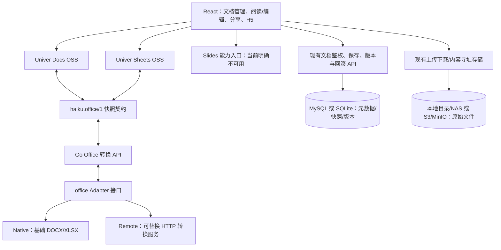

# Office 架构与能力边界

项目使用 **Univer OSS + 可替换 OOXML Adapter + Go API**。这是一套可运行的基础转换链路，不代表已经具备 Office 三格式高保真编辑能力。



## 模块边界

- `web/src/components/office/UniverOfficeEditor.tsx` 只负责创建编辑器、读取/保存快照、展示转换警告和版本历史。
- `web/src/lib/office/adapter.ts` 定义前端 `OfficeAdapter`，负责调用 Go 转换接口，以及旧附件/旧 Luckysheet 数据的兼容读取。
- `server/internal/service/office/adapter.go` 定义 Go `Adapter` 接口。转换器只接受字节和快照，不读取数据库、不获取用户文档 URL、不处理文件鉴权。
- `Native` 使用 Go 标准库解析 OOXML ZIP/XML；`Remote` 可接入另一进程或语言实现的同协议转换引擎。前端无需知道底层是何种解析库。
- 保存继续走 `PATCH /api/docs/:id`，复用现有写权限检查和版本记录。Office 附件只允许修改快照，不能修改原附件标识。其他附件仍禁止编辑。
- 原始附件不被转换结果覆盖。快照存在现有 `docs.content` 字段和版本表中，保留原件 URL/文件名/扩展名/大小。默认本地开发仍使用 SQLite；部署可沿用已有 MySQL 和 S3/MinIO 配置，不强制迁移已有数据。

## 稳定快照契约

```json
{
  "schema": "haiku.office/1",
  "kind": "doc",
  "engine": "native-ooxml/1",
  "snapshot": { "body": { "dataStream": "正文\r\n", "paragraphs": [{ "startIndex": 2 }] } },
  "warnings": ["基础转换仅保留段落文字"],
  "url": "/uploads/original.docx",
  "filename": "original.docx",
  "ext": "docx",
  "size": 1234
}
```

`kind` 为 `doc` / `sheet` / `slides`。新增文档没有附件字段；导入附件保留这些字段，以兼容原件下载、存储和回收链路。`snapshot` 是 Univer 内部快照；`disabled` 等阅读界面状态不得作为文档权限持久化。

旧的附件引用首次打开时转换，保存后才持久化快照；新 DOCX/XLSX 导入时先保留原件，再尝试转换并持久化。转换失败时仍保留原件，页面显示失败原因，不初始化空白编辑器。旧 Luckysheet v1/v2/v3 数据只在内存中迁移，首次明确保存才写入新契约。编辑需要点击“保存（手动）”；当前没有自动保存，切换前应先保存。

## Go 转换接口

统一前缀：`/api/public/office`。

| 接口 | 输入 | 输出 |
| --- | --- | --- |
| GET `/capabilities` | 无 | `{code:0,data:[{format,kind,import,export,fidelity}]}` |
| POST `/import?format=docx` | `application/octet-stream` 的 OOXML 字节 | `{code:0,data:{schema,kind,engine,snapshot,warnings}}` |
| POST `/export` | `{format:"docx",snapshot:{...}}` | OOXML 二进制；失败返回业务错误 JSON |

这些接口为无状态转换服务，公开是为了让免登录分享/H5 页面使用同一适配器。它们不接受远程 URL、数据库 ID 或存储路径，也不授予文件读取/写入权限。上游取原文件仍走原有文件链路。每个请求最多 16 MiB；最多两个并发转换；ZIP 解压最多 64 MiB / 4096 个条目；基础表格最多 100000 个单元格。错误不应触发空白文件覆盖。

转换目前在请求内同步执行，不创建后台任务队列。需要更大文件或异步任务时，应扩展独立转换服务的任务协议及状态持久化，不应延长浏览器阻塞等待或移除资源限制。

## 更换转换引擎

未设置环境变量时使用 `Native`。要启用外部转换引擎，在启动 Go 服务前设置：

```sh
export OFFICE_ADAPTER_URL=http://converter:8090/office
export OFFICE_ADAPTER_TOKEN=your-server-side-token
```

外部服务需要实现上述三个相对路径和相同数据契约；Token 仅在 Go 服务之间发送，不传浏览器。启动时探测能力接口，配置或响应无效则启动失败；请求设有超时、响应大小限制并禁止重定向。存量快照保留原始 `engine` 作为转换来源，当前导出使用所配置的适配器。外部服务应只部署在可信内网。

OpenOOXML、Office Kit、BetterOffice 等候选需要先确认具体仓库/版本、许可和部署方式，再做同一组 DOCX/XLSX/PPTX 样本的双向转换对比。当前没有集成或认可这些候选的保真度；它们的桥接实现应放在独立适配器/服务中，不进入 React 组件。

## 当前支持与限制

| 格式 | 阅读/编辑 | 当前默认转换能力 |
| --- | --- | --- |
| DOCX | Univer Docs，实际加载正文，可保存快照和导出 | 段落文字及换行；表格文字展开；图片、字体、样式、批注、页眉页脚等不保留 |
| XLSX | Univer Sheets，多工作表、数值/布尔/文字、普通公式，可保存快照和导出 | 不保留图表、样式、合并、日期格式、命名区域、宏；共享/数组公式明确拒绝转换 |
| PPTX | 原件存储/下载；页面明确提示不支持 | 当前安装的 OSS 包没有接入可用 Slides 运行时，不能冒充 Word 文档 |
| DOC/XLS/PPT | 不通过新 OOXML 适配器转换 | 旧 XLS 导入解析链路仍兼容；其他旧二进制格式须另存为 OOXML |

基础导出从当前快照生成新 OOXML，不是保留原始 ZIP 所有部件的无损回写。即使在 Univer 中新增了格式，默认导出器也仅输出上表范围。原件下载与当前快照导出是两个不同操作。PPTX 的完整编辑仍需可用的 Slides 引擎及匹配转换器，不能仅靠替换后端解析器实现。

## 验证

```sh
cd server
go test ./internal/service/office
go test ./internal/handler ./internal/service -run 'TestOfficeConversion|TestOfficeAttachment'
cd ../web
npm run verify:office
npm run build
```

Go 代码修改后需要重启 `./dev.sh`（开发脚本不热重载后端）。浏览器验证应覆盖导入、查看原正文、编辑后手动保存、切换阅读、刷新重开、历史回滚、原件下载和快照导出；不能把类型检查或模型单测等同于浏览器验收。
