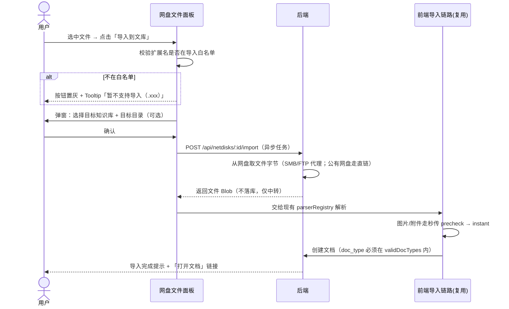
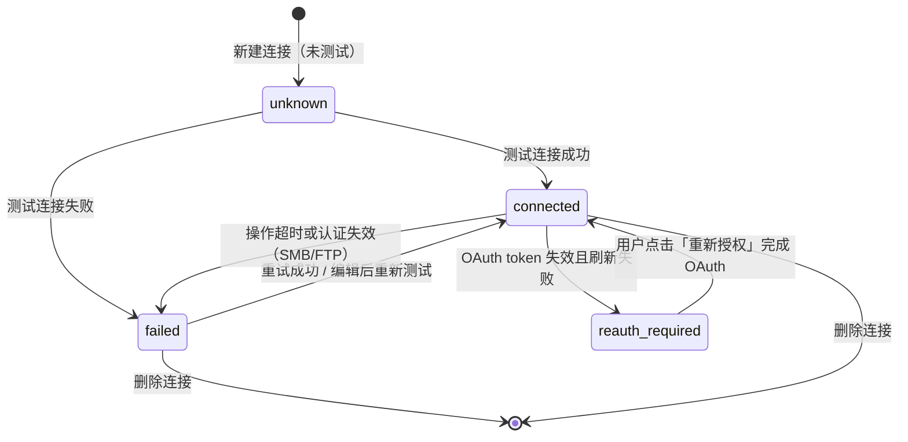

# 增量 PRD：新增「我的网盘」功能

| 项目信息 | 内容 |
| --- | --- |
| Project Name | `haiku_wiki_netdisk` |
| Language | 简体中文 |
| Programming Language | 后端 Go 1.25 + Gin + GORM（MySQL/SQLite 双驱动）+ JWT；前端 Vite 5 + React 18 + TypeScript + Ant Design |
| 文档类型 | 简单 PRD（增量） |
| 版本 / 日期 | v1.0 / 2026-10-19 |
| 目标分支 | `v1-netdisk` |
| 关联文档 | `docs/system_design.md`、`web/src/lib/import/formats.ts`、`server/internal/handler/doc_handler.go` |

---

## 0. 原始需求复述（逐字转录，未删减）

> ## 新增"我的网盘"功能
> ## "我的网盘"与"我的文库"是同一级别功能，无论是在首页还是在左边栏目录树页
> - "我的网盘"的新增功能子菜单：NAS网盘(可选SMB协议与FTP协议)、百度网盘、阿里云盘、夸克网盘等
> - NAS网盘（SMB协议）：在对话框中输入NAS服务器IP或主机名、用户名、密码，测试连接、保存连接配置
> - NAS网盘（FTP协议）：在对话框中输入NAS服务器IP或主机名、端口号、用户名、密码、连接模式等，测试连接、保存连接配置
> - 百度网盘：按百度网盘接入官方文档处理，输入账户密码登录或手机扫码登录，测试连接与保存个人连接配置
> - 网盘连接上之后：左边样的我的网盘下是网盘目录树，可一级级点开。右边文档面板是选定网盘目录的文件+目录列表
> - 网盘文件操作：新建目录、改名、移动、删除、下载、上传、预览（弹窗，仅预览文库支持的文件类型+图片+视频播放）、导入到文库（仅文库支持的文件格式）
>
> （笔误校正：」左边样」= 左边栏；」文档面板」= 右侧文件/目录列表面板）

---

## 1. §3.1 三类公有网盘官方接入可行性调研结论（核心决策依据）

> 调研时间：2026-10-19。以下每条结论均标注信息来源。凡标注「**待实测**」的，表示官方页面需登录/JS 渲染，本次无法从公开网页直接证实，需由具备账号的同学实测确认。

### 1.1 百度网盘（结论：**本期可做，但必须纠正「账号密码登录」的预期，且有硬性的应用目录隔离**）

| 维度 | 结论 | 来源 |
| --- | --- | --- |
| 是否提供第三方 OAuth2 | **是**。官方提供标准 OAuth 2.0 授权码模式（服务端应用推荐），也提供简化模式（implicit，纯前端，不支持刷新 token） | [接入流程 · 百度网盘开放平台](https://pan.baidu.com/union/doc/%E5%9F%BA%E7%A1%80%E7%BD%91%E7%9B%98%E6%9C%8D%E5%8A%A1/%E6%96%87%E4%BB%B6%E5%88%86%E4%BA%AB%E6%9C%8D%E5%8A%A1%E6%96%B0/%E5%B9%B3%E5%8F%B0%E7%AE%80%E4%BB%8B/%E6%8E%A5%E5%85%A5%E6%B5%81%E7%A8%8B/) |
| 是否提供「第三方代填账号密码」接口 | **否**。官方文档明确：「用户授权后，第三方应用**无需获取用户的用户名和密码**」。账号密码只在百度自己的授权域名（`openapi.baidu.com`）上输入，第三方永远拿不到。**用户原始需求中的「输入账户密码登录」在技术上不可实现，必须改为 OAuth 授权跳转** | 同上「3.获取授权 / step1 了解百度 OAuth」 |
| 扫码登录 | **支持**。授权 URL 追加 `qrcode=1&display=tv` 即展示登录二维码，另有 `force_login=1`（强制输入口令、不读 cookie）、`qrcodeW/qrcodeH` 控制尺寸 | 同上「2.1 引导用户授权」参数表 |
| 授权凭证 | `client_id`(APP KEY) + `client_secret`(SECRET KEY) + `redirect_uri`（必须在控制台安全设置预配置，支持多个）；`code` 一次性、10 分钟过期；`access_token` 有有效期，`refresh_token` **有效期 10 年** | 同上「2.2–2.4」 |
| 开发者资质 | 百度账号登录 → 同意《百度网盘开放平台开发者服务协议》→ 申请接入 → 控制台创建应用 → 获取 Appid/AK/SK/Signkey | 同上「1.成为开发者 / 2.创建应用」 |
| **应用目录隔离（最关键约束）** | 第三方应用在用户网盘中**默认只有一个有权限的目录**：`/apps/{appname}`，用户在网盘中看到的路径是 **`/我的应用数据/{appname}`**。官方明文禁止访问「权限外目录」，并列为违规（可被限制/收回接口权限）。**即：接入后我们只能浏览和操作「我的应用数据/寄海文库」这一个目录，无法浏览用户整个网盘** | [权限与配额 · 百度网盘开放平台](https://pan.baidu.com/union/doc/%E4%BD%BF%E7%94%A8%E5%85%A5%E9%97%A8/%E6%9D%83%E9%99%90%E4%B8%8E%E9%85%8D%E9%A2%9D/) |
| 配额/限流（未审核应用） | **频率 10 次/小时，最大可授权用户数 10 个**。超限用户返回错误码 `20011`；超频返回 `20012`；无接口权限返回 `20013` | 同上「权限与配额分配」表 |
| 配额/限流（已审核应用） | 按需分配（**白名单制**），用户数不限制。**因此生产上线前必须提交「应用上线审核」** | 同上 |
| 上传能力 | 三段式：预上传(precreate) → 分片上传(superfile2) → 创建文件(create)。**分片数 ≤ 1024**；单文件上限：普通用户 4GB / 会员 10GB / 超级会员 20GB。上传路径必须以 `/apps/{appname}/` 开头 | [上传能力说明](https://pan.baidu.com/union/doc/%E5%9F%BA%E7%A1%80%E7%BD%91%E7%9B%98%E6%9C%8D%E5%8A%A1/%E4%B8%8A%E4%BC%A0/%E8%83%BD%E5%8A%9B%E8%AF%B4%E6%98%8E/) |
| 文件管理 API | 官方提供文件/目录的查询、上传、下载、删除、移动、复制等接口（均受上表目录权限边界约束） | 同上「权限边界要求」 |

**分档建议：本期可做（P1），但需两个前置动作**
1. **前置动作 A（产品预期管理）**：必须在 UI 明确告知用户「百度网盘出于安全策略，第三方应用只能访问『我的应用数据/寄海文库』目录」。目录树的根即固定为该目录，不做全盘浏览。**这一点必须让用户拍板接受，否则整个百度网盘接入的价值主张要重估。**
2. **前置动作 B（合规）**：提交百度网盘「应用上线审核」，否则线上只能服务 10 个用户、10 次/小时。

**对原始需求的改写建议（P0 措辞）**：
> 「百度网盘：按百度网盘开放平台官方文档接入，采用 OAuth 2.0 授权 —— 点击『连接百度网盘』后跳转百度官方授权页，用户可选择**扫码授权**或**在百度页面输入账号密码登录**，授权后回调换取 access_token / refresh_token 并自动保存。应用无权限获取用户密码。」

---

### 1.2 阿里云盘（结论：**本期降级 P1 —— 技术上有官方 OpenAPI，但有商业权益门槛 + 入驻状态待实测**）

| 维度 | 结论 | 来源 |
| --- | --- | --- |
| 是否存在官方 OpenAPI | **是**。阿里云盘（消费级，`alipan.com`）有开放平台与 OpenAPI（如 `https://api.aliyundrive.com/adrive/v1/file/list` 等），第三方生态活跃：AList、CloudDrive、小白羊云盘、蜗牛云盘、Infuse、Fileball 等均在列 | [阿里云盘 · 探索三方应用](https://alipan.com/download/externalApplications)；[BoxPlayer 源码级接口解析](https://blog.gitcode.com/47bf8ef9884b4126c095e175eae01ba7.html) |
| 授权方式 | OAuth 2.0，支持 `code` 授权码模式；社区 SDK 归纳为 `pkce`（无后端，无 refresh_token）/ `server`（需服务端，可拿 refresh_token）/ `secret` 三种凭证模式；并支持**二维码授权**（获取二维码 → 阿里云盘 App 扫码 → 换 token） | [aliyunpan-flutter-sdk（非官方 SDK，反映官方能力面）](https://gitgub.com/Allenxuxu/aliyunpan-flutter-sdk) |
| **三方应用权益包（商业门槛）** | 官方上线「三方应用权益包」（约 **10 元/月**，含 1TB 三方流量）。**未购买的用户仍可访问所有接口，但**：单文件下载链接并发限制（单用户单应用 2 / 单用户 3，超限返回 **403**）、视频转码仅标清（HD/FHD/QHD 返回空）、单文件上传上限 100GB（购买后 1TB）、回收站 7 天（购买后 60 天）、**WebDAV / 挂载盘不可用** | [三方权益包说明（官方 yuque 文档转引）](https://zhp3k52owb.feishu.cn/wiki/Uv5Lw1mfsij1cHkLxWYcYWJonIt)；[IT之家/腾讯新闻报道](https://new.qq.com/rain/a/20240424A061F400)；[搜狐 6.0 版本预告](https://m.sohu.com/a/788934427_121894855) |
| 应用分级机制 | 官方上线应用分级（风险/普通/优质），等级影响接口调用配额、下载链接有效期、认证标识等；默认「普通应用」 | [腾讯新闻报道](https://news.qq.com/rain/a/20240425A07UWS00) |
| 新开发者入驻状态 | **待实测**。`https://www.alipan.com/developer` 仅返回标题「阿里云盘开发者门户」，为 JS 渲染且需登录，公开网页无法证实 2026 年是否仍开放新应用创建 | 本次 WebFetch 实测（2026-10-19） |
| 易混淆项 | **阿里云「网盘与相册服务 PDS（开发者版）」不是阿里云盘**。PDS 是让开发者**自建**网盘服务的企业级产品（需开通 domain、创建应用），不能用来接入用户已有的阿里云盘 | [PDS 产品介绍 · 阿里云](https://help.aliyun.com/en/pds/drive-and-photo-service-dev/product-introduction-1) |

**分档建议：本期降级 P1，先做 1 人日技术预研（spike）**
- 预研必须回答：① 能否成功注册/登录开发者门户并创建应用；② 未购权益包状态下的真实限速是否可接受；③ refresh_token 有效期与刷新链路。
- 即使接入，UI 必须对未购权益包用户给出明确提示（「当前账号未开通三方应用权益包，下载速度为标准通道、视频为标清」）。

---

### 1.3 夸克网盘（结论：**本期不做 —— 无官方开放 API**）

| 维度 | 结论 | 来源 |
| --- | --- | --- |
| 是否有官方开放平台 / 开放 API | **没有**。夸克网盘未向第三方开发者开放标准 RESTful/GraphQL API，`developer.quark.cn` 仅提供夸克浏览器插件、AI 能力调用与广告投放接口，**网盘核心能力（上传/下载/目录管理/分享链接）完全缺席**；无 OAuth2.0 授权流程、无 AppKey 申请入口、无正式接口文档 | [CSDN 问答 · 夸克网盘 API 是否开放第三方调用](https://ask.csdn.net/questions/9502502)；[同题另一答](https://ask.csdn.net/questions/9565492)；[三家网盘开放能力实测对比（2026）](https://blog.csdn.net/wangpankantan/article/details/163758348) |
| 社区「可用 API」的性质 | 均为**逆向/复用网页端内部接口**（如 `cloudquark.sm.cn/api/v1/file/list` + Cookie 中的 `BDUSS`/`STOKEN`），存在：设备指纹校验、动态签名、请求头白名单、`429` 限流、Cookie 约 30 天过期 | [OpenList/AList 挂载夸克实践](https://www.mwwr.cn/news_show/145112.html) |
| 合规风险 | 逆向调用违反《夸克用户协议》关于**禁止自动化访问**的约定；阿里系对夸克采取「能力内聚、服务闭环」策略，暂无对外开放计划 | 同上 CSDN 问答 |

**分档建议：本期不做，产品处置如下**
1. 「新增网盘」子菜单中**保留「夸克网盘」项但置灰**，hover/点击给出说明：「夸克网盘官方暂未开放第三方 API，开通后第一时间支持」。保留入口可向用户传达 roadmap，且未来开放时无需改信息架构。
2. 提供可持续的替代方案：**新增「通用 WebDAV」协议支持（P2）**。用户可自行用第三方工具将夸克挂载为 WebDAV，我们接标准协议即可覆盖 —— 这比逐家适配私有 API 更可持续，也是对抗「网盘厂商 API 政策摇摆」（阿里云盘权益包就是前车之鉴）的架构级对策。

---

### 1.4 NAS（SMB / FTP）（结论：**本期可做，P0**）

无第三方平台依赖、无审核、无配额、无目录隔离，凭据由用户自持。SMB2/3 与 FTP 在 Go 生态均有成熟客户端库（如 `hirochachacha/go-smb2`、`jlaffaye/ftp`），风险最低、价值最直接，**应作为 MVP 的绝对主力**。

> ⚠️ 需求补洞：SMB 除了「IP/主机名 + 用户名 + 密码」，**技术上还必须提供「共享名（share）」**才能定位到可浏览的根目录（形如 `\\host\share`）。原始需求未列此字段，见 §6 待确认问题 Q1。

---

### 1.5 分档总表

| 网盘类型 | 协议/方式 | 官方 API | 分档 | 关键前提 |
| --- | --- | --- | --- | --- |
| NAS | SMB | 协议标准，无需平台授权 | **P0 本期可做** | 需补「共享名」字段 |
| NAS | FTP | 协议标准，无需平台授权 | **P0 本期可做** | 默认被动模式 |
| 百度网盘 | OAuth 2.0 授权码 | 有 | **P1 本期可做** | ① 接受 `/apps/{appname}` 目录隔离；② 通过应用上线审核 |
| 阿里云盘 | OAuth 2.0 | 有 | **P1 本期降级** | ① 预研入驻可行性；② 接受权益包限速并做 UI 提示 |
| 夸克网盘 | — | **无官方 API** | **本期不做（置灰）** | 逆向违反用户协议；替代方案走 WebDAV(P2) |

---

## 2. 产品定义

### 2.1 Product Goals（可量化）

| # | 目标 | 量化指标 |
| --- | --- | --- |
| G1 | 建立统一的「网盘连接」抽象，让用户在一个入口管理多类外部存储 | MVP 上线支持 **2 类**（NAS-SMB、NAS-FTP）生产可用；「测试连接」3 秒内返回结果，配置保存成功率 ≥ 95% |
| G2 | 在文库内完成网盘文件的浏览与组织，避免「下载到本地 → 再上传」的往返 | 网盘目录树单级懒加载 P95 ≤ 1.5s（1000 条目内）；新建/改名/移动/删除操作 P95 ≤ 2s |
| G3 | 打通「网盘文件 → 文库文档」的最短路径，复用现有导入解析器 | 文库支持格式的导入成功率 ≥ 98%；单文件 ≤ 100MB 的导入任务 P95 ≤ 30s；**不新增任何后端解析器** |
| G4 | 凭据安全零泄漏 | 凭据服务端加密存储；前端接口返回值中**永不出现明文密码/token**；预览/下载不暴露凭据 |

### 2.2 User Stories（JTBD 风格）

| # | 用户故事 | 验收要点 |
| --- | --- | --- |
| US1 | 作为**自有 NAS 的知识工作者**，我想在文库里直接挂载我的 SMB/FTP 共享目录，这样我就不必在 NAS 网页端下载、再回文库上传，来回倒腾 | 配置一次连接后，目录树可直接展开到共享根目录 |
| US2 | 作为**百度网盘用户**，我想授权文库访问我的网盘文件，这样我能把网盘里的资料一键导入成文库文档，而不必先落到本地磁盘 | OAuth 授权完成后回到文库，连接状态显示「已连接」 |
| US3 | 作为**资料整理者**，我想在网盘面板里新建目录/改名/移动/删除，这样我不必离开文库去打开网盘官方客户端做整理 | 四类操作均在当前目录内即时生效并刷新列表 |
| US4 | 作为**内容读者**，我想先预览网盘里的 PDF/图片/视频再决定要不要导入，这样我不会把无关文件灌进文库 | 预览弹窗支持文库类型 + 图片 + 视频播放 |
| US5 | 作为**安全敏感的用户**，我希望 NAS 密码和网盘 token 被加密保存、界面上永不回显明文，这样我可以放心在共用环境使用 | 编辑连接时密码框为「已保存，留空则不修改」形态 |
| US6 | 作为**网络环境不稳定的用户**，当上传/下载/导入失败时，我希望看到明确原因并能一键重试，这样我不会对着转圈的进度条干等 | 任务失败展示可读原因 + 「重试」按钮 |

---

## 3. 需求池（Requirements Pool）

### 3.1 P0 — Must Have（MVP 闭环，NAS-SMB / NAS-FTP）

| ID | 需求 | 说明 | 验收标准 |
| --- | --- | --- | --- |
| P0-1 | 网盘连接管理（个人级） | 新增 / 编辑 / 删除 / 列表查询；本期仅**个人级**归属 | 连接列表按创建时间倒序；删除有二次确认；删除后该连接的所有缓存目录树失效 |
| P0-2 | SMB 连接配置对话框 | 字段：显示名称、服务器 IP 或主机名、共享名(share)、用户名、密码、域（可选）、**测试连接**、保存 | 测试连接在 3s 内返回成功/失败；失败时展示可读原因（主机不可达 / 认证失败 / 共享名不存在）；校验通过后才允许保存 |
| P0-3 | FTP 连接配置对话框 | 字段：显示名称、服务器 IP 或主机名、端口号（默认 21）、用户名、密码、**连接模式（主动/被动，默认被动）**、**测试连接**、保存 | 同 P0-2；切换主动/被动后测试连接结果正确反映；端口非法（非 1–65535）前端拦截 |
| P0-4 | 连接状态模型 | 枚举：`unknown`(未测试) / `connected`(已连接) / `failed`(连接失败) / `reauth_required`(需重新授权，公有网盘专用) | 状态在连接卡片、目录树节点、顶栏入口三处一致；`failed` 状态展示 `last_error` 摘要 |
| P0-5 | 左侧「我的网盘」分组 + 目录树 | 与「私人/团队/公司知识库」**同级别**的顶层分组，下挂各连接节点；连接下是网盘目录树，**逐级点开按需拉取** | 见 §4.2；目录树懒加载 + 缓存（见 §3.4） |
| P0-6 | 右侧文件/目录列表面板 | 列：名称、类型、大小、修改时间；**目录优先排序**；顶部面包屑；刷新按钮；空态 | 点击目录进入下一级并同步更新面包屑与目录树选中态 |
| P0-7 | 新建目录 | 在当前目录创建 | 成功后列表与目录树同步刷新；重名时返回可读冲突提示 |
| P0-8 | 改名 | 文件与目录均可改名 | 同上；空名/非法字符（`/` `\` 等）前端拦截 |
| P0-9 | 移动 | 弹窗选择目标目录（网盘内树形选择） | 移动后源目录与目标目录均刷新；禁止移动到自身子目录 |
| P0-10 | 删除 | 文件与目录均可删除；目录删除有二次确认（提示含子项数量） | 删除后列表刷新；失败展示原因 |
| P0-11 | 下载 | 单文件 / 多选批量下载 | 浏览器触发下载；大文件有进度提示 |
| P0-12 | 上传 | 本地文件 → 当前网盘目录，带实时进度 | 见 §3.4 任务化策略；支持取消 |
| P0-13 | 预览弹窗 | 弹窗预览，**仅限白名单**：文库支持类型 + 图片 + 视频（+ 音频，见 Q8） | 见 §3.3 白名单；非白名单文件的「预览」按钮禁用并给出原因 |
| P0-14 | 导入到文库 | **仅文库支持的格式**；选择目标知识库（+ 可选目标目录）后导入 | 复用现有前端解析链路（见 §3.5）；成功后可跳转到新文档 |
| P0-15 | 凭据加密存储与脱敏 | 服务端加密落库；前端返回值不含明文 | 编辑态密码框显示「已保存，留空则不修改」；抓取接口响应体中无 `password` / `token` 明文字段 |
| P0-16 | 首页「我的网盘」区块 | 与「书架」区块**同级别**的平行区块 | 见 §4.1 |

### 3.2 P1 — Should Have

| ID | 需求 | 说明 | 验收标准 |
| --- | --- | --- | --- |
| P1-1 | 百度网盘 OAuth 接入 | 授权跳转 → 回调换 token → 自动保存；支持扫码；refresh_token 自动刷新；根目录固定为 `/apps/{appname}` 并在 UI 明示 | 授权完成后状态 `connected`；token 过期自动刷新无需用户重登；目录树根展示为「我的应用数据/寄海文库（百度网盘应用目录）」 |
| P1-2 | 阿里云盘 OAuth 接入 | 依赖 §1.2 预研结论 | 同 P1-1；未购权益包时给出降级提示 |
| P1-3 | 上传/下载/导入 任务化 | 异步任务 + 进度 + 取消 + 失败重试 + 任务中心 | 见 §3.4；任务状态持久化（多实例部署下不丢状态） |
| P1-4 | 视频预览支持 Range 拖动 | 后端预览接口支持 HTTP `206 Partial Content` | 进度条可拖动seek；SMB/FTP 走后端代理流同样支持 |
| P1-5 | 批量操作 | 多选删除 / 多选移动 / 多选下载 / 多选导入 | 批量任务有整体进度；部分失败时逐项展示原因 |
| P1-6 | 连接管理增强 | 重命名、启用/禁用、排序、连接数上限提示 | 禁用后目录树该节点置灰、不发起请求 |
| P1-7 | 当前目录内文件名过滤 | 客户端本地过滤（不依赖网盘侧搜索 API） | 输入即时过滤；大小写不敏感 |
| P1-8 | 通用 WebDAV 协议 | 作为夸克等「无 API 网盘」的可持续替代 | 配置字段：URL、用户名、密码；与 SMB/FTP 并列 |
| P1-9 | 网盘直链预览（公有网盘） | 百度/阿里可换取临时直链时，优先用直链而非后端代理，降低服务器带宽 | 直链过期自动重新换取 |

### 3.3 P2 — Nice to Have

| ID | 需求 | 说明 |
| --- | --- | --- |
| P2-1 | 夸克网盘接入 | 官方开放 API 后再做；本期菜单置灰 + 说明 |
| P2-2 | 团队级共享网盘连接 | 连接归属从「个人」扩展到「团队」，含成员权限（只读/读写） |
| P2-3 | H5 手机版 | 只读浏览 + 预览 + 导入到文库；见 §3.6 |
| P2-4 | 网盘 ↔ 文库双向同步 | 定时增量同步、冲突策略 |
| P2-5 | 「不解析，仅作附件引用」导入 | 导入为 `doc_type=file` 而不过解析器，支持任意格式进文库 |
| P2-6 | 回收站 / 版本 | 依赖网盘侧能力，能力缺失时置灰 |
| P2-7 | SFTP / S3 / NFS 协议扩展 | 补充协议覆盖 |

### 3.4 关键技术决策

**A. 同步 vs 异步（文件操作）**

| 操作 | 策略 | 理由 |
| --- | --- | --- |
| 列目录 / 新建目录 / 改名 / 移动 / 删除 | **同步请求 + loading 态**，单个请求超时 15s | 网盘侧单操作耗时短，同步更简单、反馈更直接 |
| 上传 / 下载 / 导入到文库 | **异步任务**（P1 落库，P0 可先用内存任务 + 前端进度） | 大文件 + 网盘侧慢 + 易失败，必须可看进度、可取消、可重试；同步阻塞会让请求超时 |
| 预览 | 流式（后端代理流或直链），不落盘 | 无需持久化 |

- **失败重试**：网络类错误采用指数退避（1s/2s/4s，最多 3 次）；业务类错误（权限不足、配额超限、文件不存在）**不自动重试**，直接给出可读原因 + 手动「重试」按钮。
- **错误码映射**：需把各协议/平台的原始错误翻译为用户可读文案（例：百度 `20011` 用户数超限 / `20012` 超频 / `20013` 无权限；阿里云盘 `403` 下载并发超限 → 「当前下载并发已达上限，请稍后重试」）。
- ⚠️ **现状提醒**：当前后端 `server/internal/service/` 下**不存在任何异步任务基础设施**（无 task/job 表、无 worker 池）。P1-3 需要新增 `netdisk_task` 表 + 调度器。若未来多实例部署，任务状态必须落库而非内存。

**B. 目录树懒加载与缓存**

- 逐个节点按需拉取，选中连接时只加载根目录；**不做递归预取**。
- 前端缓存：`Map<connectionId:path, {items, ts}>`，TTL 5 分钟（可按连接配置覆盖）。
- 写操作（新建/改名/移动/删除/上传）后，**失效该目录及其祖先链上受影响节点的缓存**并重新拉取。
- 单目录条目 > 200 时列表分页/滚动加载（目录树节点不分页，只提示「内容较多」）。
- SMB/FTP 建议后端维护**短空闲 TTL 的连接池**（如空闲 10 分钟断开），避免每次列目录都重新握手。

**C. 连接状态**

必须建立。四态：`unknown` / `connected` / `failed` / `reauth_required`。公有网盘 OAuth token 失效时进入 `reauth_required`，UI 提供「重新授权」按钮。

**D. 预览 / 导入 格式白名单**（这是本 PRD 中最需要「照抄现有代码事实」的部分）

**D-1 导入到文库白名单 ——「仅文库支持的格式」**
直接复用 `web/src/lib/import/formats.ts` 的 `IMPORT_EXTENSIONS`，并剔除解析器明确拒绝的 `wps` / `dps`：

| 分类 | 扩展名 |
| --- | --- |
| 文本 / Markdown | `md`, `markdown`, `txt` |
| Markdown 包 | `zip`（.md.zip，含图片） |
| 网页 | `html`, `htm` |
| PDF | `pdf` |
| Word | `docx`, `doc` |
| Excel | `xlsx`, `xls`, `csv`, `et` |
| PPT | `pptx` |
| 思维导图 | `smm`, `km`, `xmind`, `mm` |
| 绘图 | `drawio` |
| 白板 | `excalidraw` |
| Visio | `vsd`, `vsdx` |

> 明确不支持：`wps`, `dps`（现有解析器 `failUnsupported` 会返回友好拒绝文案，应复用该文案而非另写一套）。

**D-2 预览白名单 ——「文库支持类型 + 图片 + 视频」**

| 分类 | 扩展名 | 渲染方式 |
| --- | --- | --- |
| 文库可渲染（复用现有） | `pdf`, `docx`, `xlsx`, `pptx`, `drawio`, `vsd`, `vsdx`, `md`, `markdown`, `txt`, `html`, `htm` | 复用 `web/src/components/reader/` 现有渲染器（pdf.js / mammoth / FortuneSheet / pptx-preview / draw.io） |
| 图片 | 现有 `png`, `jpg`, `jpeg`, `gif`, `webp`, `bmp`, `svg`；**建议扩展** `ico`, `tif`, `tiff`, `avif` | `` / 图片查看器 |
| **视频（新增能力）** | `mp4`, `webm`, `ogv`, `mov`, `mkv`, `avi`, `flv`, `m3u8` | HTML5 `<video>`；需 Range 支持（P1-4） |
| **音频（新增，见 Q8）** | `mp3`, `wav`, `ogg`, `flac`, `aac`, `m4a` | HTML5 `<audio>` |
| **纯文本（新增，见 Q8）** | `json`, `xml`, `yaml`, `yml`, `ini`, `log`, `sql` 及常见代码后缀 | `<pre>` 纯文本展示（与现有未知类型兜底一致） |

> 注意：现有 `web/src/lib/attachment.ts` 的 `attachmentKind()` 只识别 `pdf/docx/pptx/drawio/image`，未覆盖视频、音频、纯文本。**预览弹窗需要新增一个独立的「网盘预览类型判定」函数**，不要污染 `attachmentKind()`（后者服务于文库附件文档，语义不同）。

**E. 导入链路必须复用，不另起炉灶**

- 现有导入解析器（`web/src/lib/import/parse.ts` 的 `parserRegistry`）运行在**浏览器侧**，依赖 `DOMParser` / `xlsx` / `turndown` / `DOMPurify` 等 JS 生态库。
- 因此「导入到文库」的正确姿势是：**后端只负责把网盘文件的字节取回来交给前端（Blob），解析与入库完全复用现有前端链路**（桌面 `ImportDialog` / H5 `runImport.ts` 共享的核心）。
- **明确禁止**：在 Go 后端重写一套 docx/xlsx/pdf/HTML 解析器 —— 既重复造轮子，又必然与前端解析结果漂移。
- 复用点还包括：秒传能力（`POST /api/uploads/precheck` → `/api/uploads/instant`，见 `web/src/api/uploads.ts`）—— 导入产生的图片/附件应继续走秒传。

**F. 凭据与传输安全**

- 凭据**只在后端**使用，绝不返回前端：接口返回体中密码字段统一为 `has_password: boolean`，OAuth token 不下发。
- 落库加密（AES-GCM，密钥从服务端配置读取）。
- SMB/FTP 无 HTTP 直链，**预览/下载必须后端代理流式转发**，需支持 Range（P1-4）。
- 日志脱敏：任何连接配置的日志输出不得包含密码/token。

### 3.5 与现有代码的关系（架构师须知）

| 现有资产 | 复用方式 |
| --- | --- |
| `server/internal/{router,handler,service,repository,model,storage}` 分层 | 新增 `netdisk_handler.go` / `netdisk_service.go` / `netdisk_repo.go` / `netdisk.go`(model)；协议客户端建议放 `server/internal/netdisk/{smb,ftp,baidu,aliyun}.go`（可参照 `storage/` 的 `local.go` + `s3.go` 双驱动范式） |
| `jwt := api.Group("", middleware.JWTAuth())`（`router.go` L58） | 新增 `netdisks := jwt.Group("/netdisks")` 子分组，沿用现有 JWT 中间件 |
| `validDocTypes`（`doc_handler.go` L40） | 导入入库的 `doc_type` 必须落在该枚举内 |
| `web/src/lib/import/formats.ts` / `parse.ts` | 导入白名单与解析器的**唯一事实来源**，禁止在网盘模块另写一份 |
| `web/src/components/reader/DocContent.tsx` | 预览弹窗内嵌复用；`widthEditable={false}` |
| `web/src/lib/attachment.ts` `attachmentKind()` | 不改动，另建网盘预览类型判定 |
| `web/src/components/tree/KnowledgeTree.tsx` | 新增顶层「我的网盘」分组（现有顶层为 `private`/`team`/`company` 三类，见 L115-117） |
| `web/src/components/book/BookshelfSection.tsx` | 首页在其下方新增平行的「我的网盘」区块（现有区块标题为「书架」，见 L114） |
| `web/src/layouts/AppLayout.tsx` | 顶栏新增「我的网盘」图标入口（现有：我的知识库/团队/模板中心/回收站，见 L84-95） |
| `server/internal/storage/` 双驱动 | 网盘协议客户端的接口抽象参照该包的 `storage.go` 接口风格 |

### 3.6 H5 手机版范围结论：**本期不纳入（P2）**

**结论**：本期 H5 零改动。

**理由**：
1. 网盘文件管理是**重度桌面交互**（三栏布局：目录树 + 列表 + 预览弹窗 + 拖拽上传），H5 单列布局需重新设计整套信息架构，成本接近重写。
2. 项目现状明确：**桌面与 H5 是两条独立的导入链路**，任何行为变更都必须同步改造两边（`ImportDialog` vs `runImport.ts`）。本期先收敛桌面，可避免双倍开发成本与双倍回归风险。
3. 用户原始需求全文未提及手机端，桌面优先符合真实诉求。

**风险对冲**：H5 `MHome.tsx` 的「我的文库」区块本期**不加入口**（不置灰），避免产生「点了没反应」的负面体验；P2-3 再统一加入。

---

## 4. UI 设计稿说明

### 4.1 首页「我的网盘」区块（与「书架」同级别）

- 位置：DashboardPage 中 `BookshelfSection` 之后，**同级 `<section>`**，同样带 `hk-dash-section-title` 标题「我的网盘」与右上角「+ 新增网盘」按钮（Dropdown 触发，见 §4.2）。
- 内容：连接卡片网格（复用 `BookCard` 的视觉尺寸以保持一致），每张卡片展示：
  - 网盘类型图标 + 连接显示名称
  - 副信息：类型标签（SMB / FTP / 百度网盘 / 阿里云盘）+ 主机或账号
  - 右上角状态徽标：`已连接`(绿) / `未连接`(灰) / `连接失败`(红) / `需重新授权`(橙)
  - 悬浮显示「编辑 / 删除」操作
- 空态：`<Empty description="还没有网盘连接，点击右上角新增" />`
- 点击卡片 → 进入该网盘的网盘页（`/netdisk/:id`）。

### 4.2 「新增网盘」Dropdown 子菜单

在「+ 新增网盘」按钮（首页区块右上角 / 目录树分组标题旁）点击后弹出 Antd `Dropdown` 二级菜单：

```
新增网盘 ▾
├─ NAS 网盘（SMB 协议）     → 打开 SMB 配置对话框
├─ NAS 网盘（FTP 协议）     → 打开 FTP 配置对话框
├─ 百度网盘                 → 触发 OAuth 授权跳转
├─ 阿里云盘                 → 触发 OAuth 授权跳转（P1）
└─ 夸克网盘                 → 置灰 + Tooltip「官方暂未开放第三方 API」
```

### 4.3 SMB 配置对话框（Modal，单步）

| 字段 | 控件 | 校验 |
| --- | --- | --- |
| 显示名称 | Input | 必填，≤ 50 字，同用户下不重名 |
| 服务器地址 | Input | 必填，IP 或主机名 |
| 端口 | InputNumber | 选填，默认 445 |
| 共享名 (share) | Input | 必填，如 `share` / `homes` |
| 用户名 | Input | 必填（匿名见 Q14） |
| 密码 | Input.Password | 必填；编辑态显示「已保存，留空则不修改」 |
| 域 (domain) | Input | 选填 |

底部：**[测试连接]**（次级按钮，左） · [取消] [保存]（右）
- 测试连接结果：成功 → 绿色 `✓ 连接成功，可访问 N 个根目录条目`；失败 → 红色可读原因。
- **必须先测试连接成功才允许点保存**（或允许强制保存但标记为 `unknown`，建议前者）。

### 4.4 FTP 配置对话框（Modal，单步）

| 字段 | 控件 | 校验 |
| --- | --- | --- |
| 显示名称 | Input | 必填 |
| 服务器地址 | Input | 必填，IP 或主机名 |
| 端口号 | InputNumber | 必填，默认 21，范围 1–65535 |
| 用户名 | Input | 必填（匿名见 Q14） |
| 密码 | Input.Password | 必填 |
| 连接模式 | Radio / Select | **主动(PORT) / 被动(PASV)**，默认**被动**；附一行说明「局域网或服务器无公网 IP 时请用被动模式」 |
| 字符编码 | Select | 选填，默认 UTF-8；可选 GBK（解决中文文件名乱码） |

底部同 SMB：**[测试连接]** · [取消] [保存]

### 4.5 网盘页主体布局（桌面）

```
┌──────────────┬────────────────────────────────────────────────┐
│ 左侧目录树    │ 面包屑：我的网盘 / 我的 NAS / share / 2026       │
│              ├────────────────────────────────────────────────┤
│ ▾ 我的网盘    │ 工具栏：[上传] [新建目录] [刷新] [搜索框]        │
│   ▾ 我的 NAS  ├────────────────────────────────────────────────┤
│     ▾ share  │ ☑ 名称        类型    大小      修改时间    操作 │
│       ▸ 2026 │ ─────────────────────────────────────────────── │
│       ▸ 2025 │ ☐ 📁 设计稿   目录    —        2026-09-01  ⋯    │
│   ▸ 百度网盘  │ ☐ 📄 方案.pdf PDF    2.3 MB   2026-09-12  ⋯    │
│              │ ☐ 🖼 封面.png  图片    480 KB   2026-09-12  ⋯    │
│              │ ☐ 🎬 演示.mp4  视频    120 MB   2026-09-20  ⋯    │
└──────────────┴────────────────────────────────────────────────┘
```

- 目录树节点：连接 → 目录（懒加载，逐级展开）。
- 列表行「操作」列（或右键菜单）：**预览 / 下载 / 导入到文库 / 改名 / 移动 / 删除**。
- 非白名单文件的「预览」置灰 + Tooltip「暂不支持预览（.xxx）」；非导入格式的「导入到文库」置灰 + Tooltip「暂不支持导入（.xxx）」。

### 4.6 预览弹窗

- Antd `Modal`（宽屏 `width="80vw"`），标题 = 文件名。
- 内容按 §3.4-D2 判定：
  - 文库可渲染类型 → 内嵌 `DocContent`（`widthEditable={false}`）
  - 图片 → 图片查看器（支持缩放）
  - 视频 → `<video controls>`（P1 支持 seek）
  - 音频 → `<audio controls>`
  - 纯文本 → `<pre>`（带复制按钮）
- 底部：**[下载]** · **[导入到文库]**（仅导入白名单内可用）· [关闭]

### 4.7 导入到文库流程



### 4.8 网盘连接状态流转



---

## 5. 接口清单（产品级，供架构师细化）

> 均挂在 `jwt := api.Group("", middleware.JWTAuth())` 下的 `/api/netdisks` 分组。

| 方法 | 路径 | 用途 |
| --- | --- | --- |
| GET | `/api/netdisks` | 连接列表（含脱敏状态） |
| POST | `/api/netdisks` | 新建连接（SMB/FTP 直接保存；公有网盘返回授权 URL） |
| GET | `/api/netdisks/:id` | 连接详情（凭据脱敏） |
| PUT | `/api/netdisks/:id` | 编辑连接 |
| DELETE | `/api/netdisks/:id` | 删除连接 |
| POST | `/api/netdisks/:id/test` | 测试连接 |
| POST | `/api/netdisks/:id/refresh` | 刷新连接状态 |
| GET | `/api/netdisks/:id/dirs?path=` | 列目录（懒加载） |
| POST | `/api/netdisks/:id/dirs` | 新建目录 |
| POST | `/api/netdisks/:id/rename` | 改名 |
| POST | `/api/netdisks/:id/move` | 移动 |
| DELETE | `/api/netdisks/:id/items` | 删除（文件或目录） |
| POST | `/api/netdisks/:id/upload` | 上传（任务化） |
| GET | `/api/netdisks/:id/download?path=` | 下载（代理流或直链重定向） |
| GET | `/api/netdisks/:id/preview?path=` | 预览（代理流，支持 Range） |
| POST | `/api/netdisks/:id/import` | 导入到文库（取字节 + 任务化） |
| GET | `/api/netdisk-tasks` | 任务列表 / 进度 |
| POST | `/api/netdisk-tasks/:id/retry` | 任务重试 |
| DELETE | `/api/netdisk-tasks/:id` | 取消任务 |
| GET | `/api/netdisks/oauth/:provider/authorize` | 发起 OAuth（百度/阿里） |
| GET | `/api/netdisks/oauth/:provider/callback` | OAuth 回调（换 token） |

---

## 6. 待确认问题清单（需用户拍板）

| # | 问题 | 我的建议 | 影响 |
| --- | --- | --- | --- |
| **Q1** | **SMB 是否补充「共享名(share)」字段？** 原始需求只列了 IP/主机名、用户名、密码，但 SMB 没有 share 无法定位根目录 | **必须补**，否则无法浏览 | P0 |
| **Q2** | **百度网盘应用目录隔离是否可接受？** 官方规定第三方只能访问 `/我的应用数据/寄海文库`，**无法浏览整个网盘** | 接受，并在 UI 明示；若期望全盘浏览则百度网盘接入不成立 | **决定百度网盘是否值得做** |
| **Q3** | 是否愿意提交百度网盘「应用上线审核」（未审核 = 10 用户 + 10 次/小时）？ | 必须提交，否则不可生产 | P1 |
| **Q4** | 阿里云盘：是否已有开发者账号？能否接受「三方应用权益包」约 10 元/月的成本与未购时的限速？ | 先做 1 人日预研再决定 | P1 |
| **Q5** | 夸克网盘：菜单项是「置灰保留 + 说明」还是「完全移除」？ | 置灰保留（传达 roadmap） | P0（UI 细节） |
| **Q6** | 网盘连接归属：本期只做个人级，团队级共享是否必要？ | 本期个人级；团队级放 P2 | 数据模型 |
| **Q7** | H5 手机版是否确认本期不做？ | 确认不做（理由见 §3.6） | 工作量 |
| **Q8** | 预览白名单是否包含**音频**与**纯文本/代码文件**？原始需求只写了「文库支持类型 + 图片 + 视频」 | 建议包含（成本极低，体验提升明显） | P0 范围 |
| **Q9** | 单个文件大小上限策略？（上传 / 下载 / 导入各是多少） | 建议：上传 ≤ 2GB，导入 ≤ 200MB（避免长任务） | P0 校验规则 |
| **Q10** | 每个用户最多可建几个网盘连接？ | 建议 10 个 | P0 校验规则 |
| **Q11** | 凭据加密密钥如何管理？（配置文件 / 环境变量 / KMS） | 建议随现有服务端配置走，不引入 KMS | 安全方案 |
| **Q12** | 任务状态：本期用内存任务还是落库 `netdisk_task` 表？ | P0 可用内存（单实例），P1 必须落库 | 架构 |
| **Q13** | 是否需要支持「不解析、仅作附件引用」导入（任意格式进文库）？ | 放 P2-5，本期严格按导入白名单 | P0 范围 |
| **Q14** | SMB/FTP 是否允许**匿名/免密**连接（如公开共享）？ | 建议允许，用户名密码留空即匿名 | P0 表单校验 |
| **Q15** | 预览弹窗中的视频是否需要**外挂字幕**支持？ | 本期不做 | P2 |
| **Q16** | 是否新增「通用 WebDAV」协议（P1-8），作为夸克等无 API 网盘的替代路径？ | 建议做，架构上比逐家私有 API 可持续 | 协议层设计 |

---

## 7. 明确不做（本期）

1. **夸克网盘接入** —— 无官方 API，逆向违反用户协议（§1.3）
2. **H5 手机版** —— 重度桌面交互 + 双链路改造成本（§3.6）
3. **团队级共享连接** —— 数据模型与权限体系扩张过大
4. **后端重写文件解析器** —— 必须复用现有前端解析链路（§3.4-E）
5. **网盘 ↔ 文库双向同步** —— 冲突策略复杂，超出 MVP
6. **全盘浏览百度网盘** —— 官方权限边界禁止（§1.1）
7. **接入阿里云 PDS** —— 那是让开发者自建网盘服务，与「接入用户已有阿里云盘」不是一回事（§1.2）
